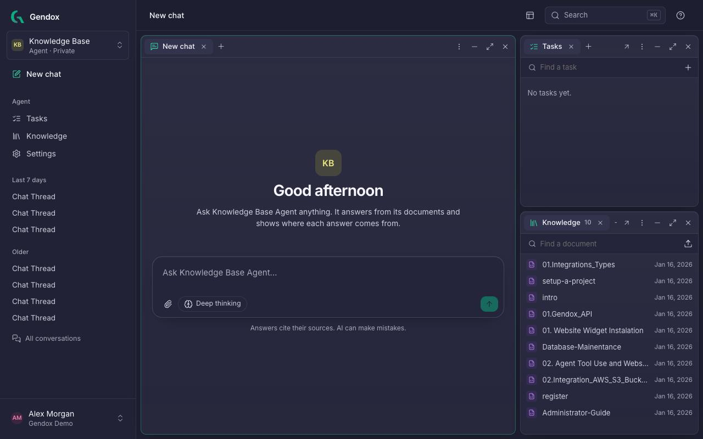
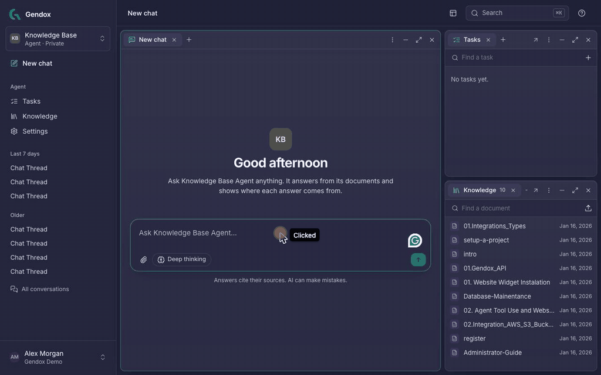
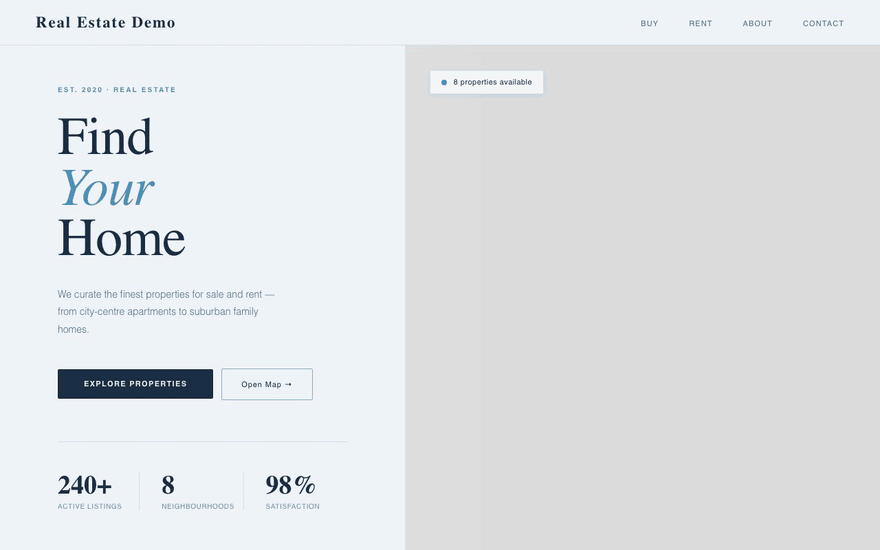
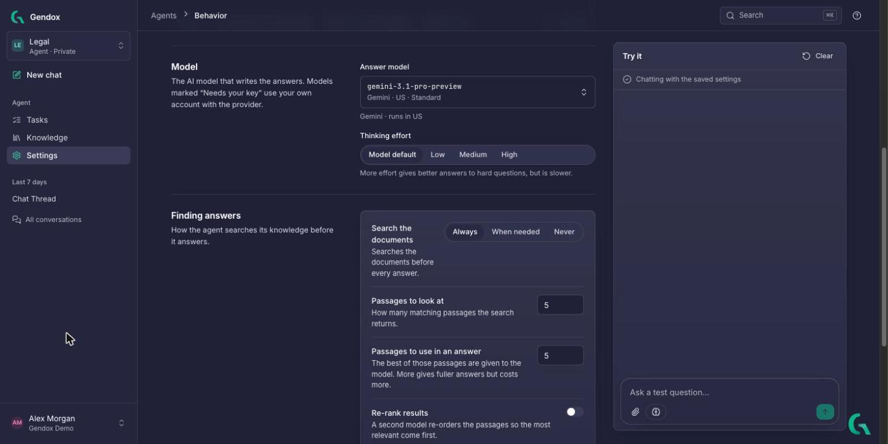
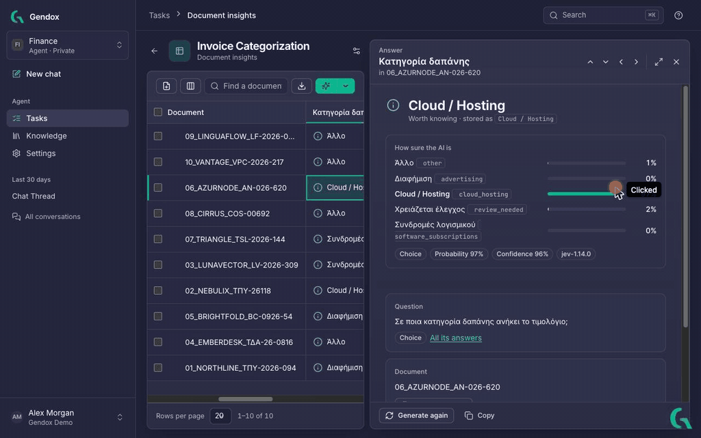
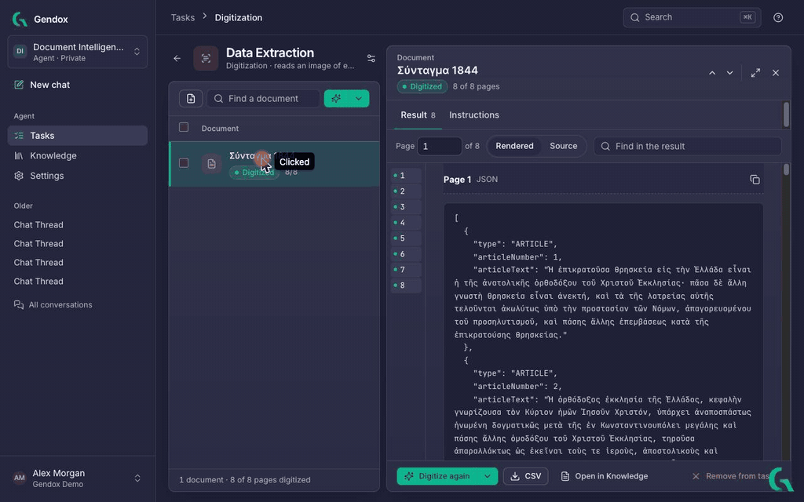

# Gendox — AI Agents & Document Intelligence Harness
**by** [Ctrl+Space Labs](https://www.ctrlspace.dev/)

Gendox is an open-source document intelligence platform for building AI knowledge bases, deploying agents and extracting structured data from documents.

As an AI agent harness, it combines document processing, retrieval-augmented generation (RAG), tool calling and batch analysis in a self-hostable platform. Agents answer questions using organizational knowledge, link to source passages and perform actions through configured tools and skills. The same agents are available in the Gendox app, through an embeddable website widget or via the REST API, with a choice of AI providers.

> **Web app:** [app.gendox.dev](https://app.gendox.dev) · **Documentation:** [docs.gendox.dev](https://docs.gendox.dev) · Open source and self-hostable



---

## Capabilities

| Capability | Description |
|---|---|
| **Knowledge bases with cited answers** | Agents search uploaded files, documents from the built-in editor, website content and synced WordPress posts, with links to source passages. |
| **Agentic websites** | An embeddable widget brings agents to websites. Configured tools let agents filter listings, fill forms and navigate pages. |
| **Configurable agents** | Each agent has its own instructions, model, reasoning settings, search behavior, tools, skills and access controls. |
| **Document analysis and extraction** | Batch tasks produce tables of answers with explanations and status flags, or extract text and structured JSON from document pages. |
| **Multiple AI providers** | Supported providers include OpenAI, Anthropic, Gemini, Mistral, Groq, Cohere, xAI and Ollama, with options for Gendox-provided access or organization-supplied API keys. |

---

## Knowledge bases with cited answers

An agent's knowledge can include PDFs, Word documents, Excel spreadsheets, CSV files, Markdown, images, documents written in the built-in editor and content imported from websites or WordPress. Gendox splits documents into sections and stores their embeddings in PostgreSQL/pgvector. Retrieval-augmented generation uses relevant passages to inform answers, with **sources** available for review.



[Knowledge →](documentation/docs/01-user-manual/knowledge.md) · [Chat →](documentation/docs/01-user-manual/chat.md)

---

## Agentic websites

The Gendox chat widget embeds an agent on a website with a single script tag. The agent can answer from its knowledge base, read text selected by a visitor and call **tools implemented by the host website**. In this example, a visitor asks a real estate website's agent for rentals in the city centre, and the agent applies the site's filters:



```html
<script
  id="gendox-chat-script"
  src="https://app.gendox.dev/gendox-sdk/gendox-widget-plugin.js"
  data-gendox-src="https://app.gendox.dev"
  data-organization-id="YOUR_ORG_ID"
  data-project-id="YOUR_AGENT_ID">
</script>
```

The agent's **Settings → Deploy** provides a deployment snippet, appearance controls and a live preview. The **Gendox WP AI Agent** plugin adds the widget to WordPress and keeps selected posts and pages in sync with the agent's knowledge. Other applications can access the agent through the REST API.

[Website widget →](documentation/docs/03-website-widget/01-website-widget-installation.md) · [Website tools →](documentation/docs/03-website-widget/02-agent-tool-use-and-website-tool-support.md) · [WordPress →](documentation/docs/03-website-widget/04-wordpress-plugin.md)

---

## Configurable agents

Each agent has its own instructions, model and knowledge. Search settings control when documents are retrieved and how many passages inform an answer. Optional moderation checks screen incoming questions. **Tools** support built-in document operations and actions in connected websites or applications. **Skills**, defined in `SKILL.md` files, provide additional instructions that the agent loads when relevant to a request.



Inside the app, the current agent also serves as the **Gendox assistant**. It uses the current page as context and can read, create and run the agent's tasks.

[Configure the agent →](documentation/docs/01-user-manual/configure-the-agent.md)

---

## Document Insights

Document Insights applies a shared set of questions to a batch of documents. Results appear in a table with one row per document and one column per question. Each answer includes a short value, an explanation and a status flag, from *Looks fine* to *Critical issue*. Questions support written responses, Yes/No decisions, choices and ratings, with reference documents such as contract templates available as context. Results include document summaries and can be exported to CSV.



[Document Insights →](documentation/docs/07-document-insights/01-document-insights.md)

---

## Document Digitization

Document Digitization extracts text from scans, PDFs and office files **page by page**. Vision models can interpret page images containing stamps, handwriting and tables, while text-based processing is available for digital documents. An optional JSON schema defines the fields to extract as structured data. Results can be reviewed per page and exported to CSV.



[Document Digitization →](documentation/docs/08-document-digitization/01-document-digitization.md)

---

## Additional features

- **Earth Observation (SeaScope)**: a satellite imagery analysis workspace combining Google Earth Engine, an interactive map and an agent that writes and runs analysis code. [Guide →](documentation/docs/06-earth-observation/02-user-guide.md)
- **Teams**: organizations, members and roles, private and public agents, API keys. [Invite people →](documentation/docs/01-user-manual/invite-user.md)
- **Integrations**: knowledge synchronization with websites, WordPress, Git repositories and S3 buckets. [Integrations →](documentation/docs/04-integrations/01-integrations-types.md)

---

## Technology stack

| Part | Stack |
|---|---|
| API | Java 25 (virtual threads), Spring Boot 3.5, Spring AI, Spring Batch, QueryDSL, Maven |
| Web app (`gendox-frontend-v2`) | Next.js 15 (static export), React 19, Redux Toolkit, its own design system |
| Data | PostgreSQL + pgvector, Flyway migrations |
| Sign-in | Keycloak (OAuth2 / OIDC) |
| Tests | Playwright end-to-end suite (`gendox-e2e-tests`) |
| Docs | Docusaurus (`documentation`) |

---

## Local deployment

The **ephemeral environment** provides a local development stack with a database, API, Keycloak and web app managed by Docker Compose. It includes seeded test users and mock models that require no API key.

Prerequisites are Docker with Compose, Java 25 with Maven, and Node.js with Yarn.

```bash
git clone https://github.com/ctrl-space-labs/gendox-core.git
cd gendox-core
(cd gendox-core-api && mvn -q package -DskipTests)
(cd gendox-frontend-v2 && yarn install && yarn build)
cd gendox-compose-scripts/ephemeral
./init-env.sh
docker compose up -d --wait
```

`init-env.sh` selects free ports and writes them to `.env`; the web app runs at `http://localhost:31NN`. Real model access requires a provider key (`OPENAI_KEY`, `ANTHROPIC_KEY`, `GEMINI_KEY`, …) in `.env` and another `docker compose up -d --wait` to apply the configuration.

Details: [Local test environments](documentation/docs/05-maintenance/ephemeral-environments.md) · [End-to-end tests](documentation/docs/05-maintenance/e2e-tests.md). Other setups are in `gendox-compose-scripts/`.

---

## For AI coding assistants

The [Agent Skills catalog](https://docs.gendox.dev/skills/) provides integration instructions for AI coding assistants. Skill folders can be installed in a consuming project's `.agents/skills/` directory for Cursor and Codex, or `.claude/skills/` for Claude Code. The [documentation index](https://docs.gendox.dev/llms.txt) provides a structured overview of the guides and references.

---

## Community

Gendox is built in the open and contributions are welcome.

- **Contributions**: [contact@ctrlspace.dev](mailto:contact@ctrlspace.dev).
- **Bug reports and feature requests**: [GitHub issues](https://github.com/ctrl-space-labs/gendox-core/issues).

---

© [Ctrl+Space Labs](https://www.ctrlspace.dev/)
