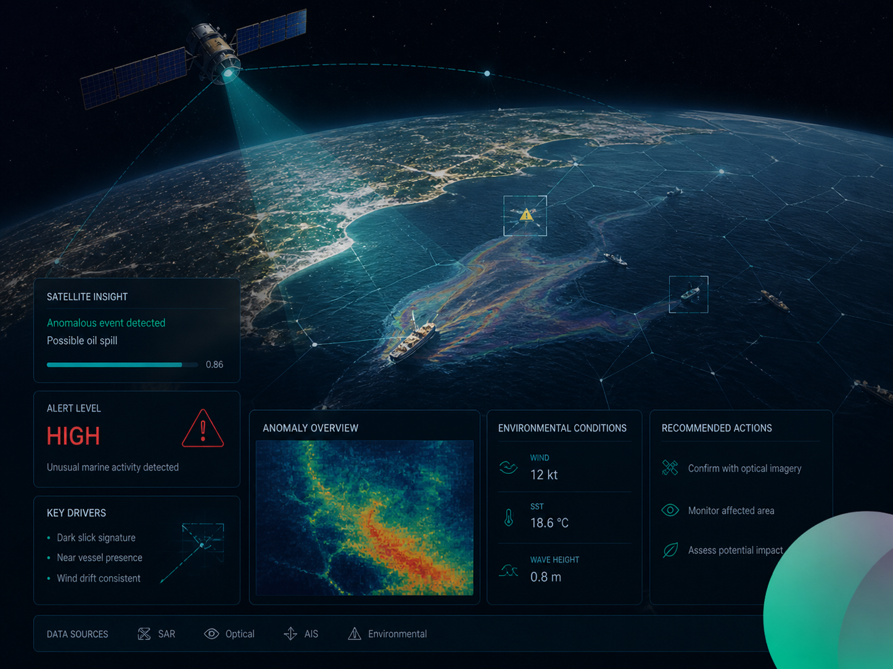

Satellite imagery and scanned documents call for different workflows from ordinary text search. This Gendox update introduces SeaScope for Earth observation, automatic digitization during document processing, and Deep thinking for questions that may need several steps.

<!-- truncate -->

## SeaScope: Earth observation with an agent

**SeaScope** brings Google Earth Engine into a workspace with an interactive map, a code editor and an AI agent. The agent can help draft and revise Earth Engine scripts from a description of the analysis. With Earth Engine connected, scripts run through the browser integration and can display their results as map layers.

The workspace supports drawing areas of interest, sharing map screenshots in the chat, keeping script versions and managing exports. The code and map layers remain available for inspection and further edits. [Read the SeaScope guide](/earth-observation/user-guide).

## Automatic digitization during document processing

When enabled for an agent, **auto-digitization** reads supported documents page by page during knowledge processing. A vision-capable model can interpret scanned pages, tables and images. The extracted text is then split into sections for search, without requiring a separate Digitization task for this workflow.

Separate **Digitization** tasks remain available for workflows that need their own extraction instructions and structured output. Tasks can read page images or the text already present in digital files. [Read the Digitization guide](/document-digitization/document-digitization).

## Deep thinking

**Deep thinking** provides a longer-running workflow for questions that may require several tool calls. It gives the agent more room to gather context and work through a request before answering. The steps taken depend on the selected model, the available tools and the question; a longer run does not guarantee a more accurate answer.

The option is available per question in the chat. [Read the chat guide](/user-manual/chat).

## Related improvements

- A **Python SDK** provides a library and command-line interface for document digitization workflows.
- **Document Insights** summaries bring together findings from the questions answered for each document.
