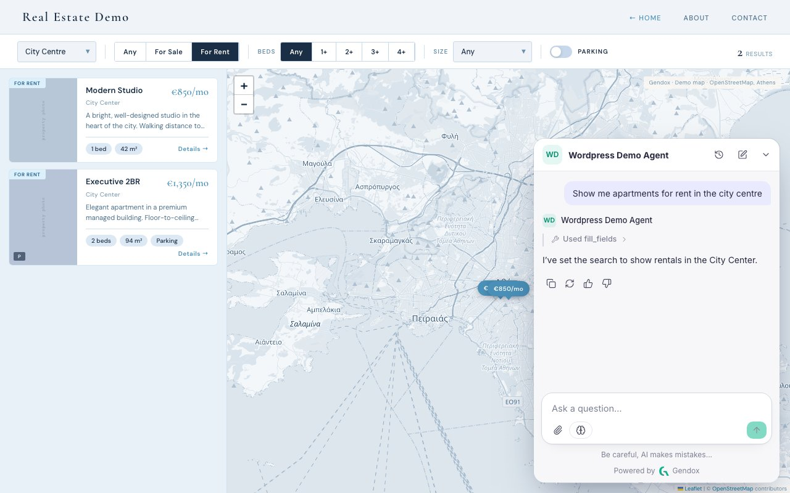

This Gendox update connects agents to WordPress sites and adds structured decisions to Document Insights. It also introduces reasoning summaries from supported models and more control over which document pages a digitization task processes.

<!-- truncate -->

## The Gendox WP AI Agent plugin

The **Gendox WP AI Agent** plugin adds the Gendox chat widget to WordPress without a manual theme edit. An administrator connects a Gendox account with an API key, assigns content to an agent and chooses where the widget appears. Selected posts, pages and products can then be synchronized with the agent's knowledge.

Website actions use agent tools. Page navigation can be enabled through the widget; custom actions, such as setting listing filters or filling forms, require tool handlers implemented by the website. Installing the plugin alone does not add those custom workflows.

[Set up the WordPress plugin](/website-widget/wordpress-plugin).

## Decisions in Document Insights

A question in **Document Insights** can return a **decision**: Yes/No, a choice from a defined list, or a rating. For example, an invoice analysis task can assign an expense category, while a contract review task can check whether a termination clause is present. Each answer includes an explanation for review alongside the selected value.

The results table supports searching by document title, sorting by a question's answer and filtering by answer status. Results can be exported to CSV, and document summaries can be enabled or disabled for a task.

[Read the Document Insights guide](/document-insights/document-insights).

## Reasoning models

Gendox adds support for the OpenAI Responses API and can display a **reasoning summary** alongside an answer when the selected model and provider return one. Summary availability and reasoning controls depend on the model; they are not shared by every provider or response.

## More control over digitization and conversations

Digitization supports page ranges for individual documents, so a task can process a relevant section rather than the entire file. Selecting documents limits generation to the missing results for those files.

The embedded chat can also resume a previous conversation within its configured retention period. [Read the widget guide](/website-widget/website-widget-installation) for conversation and deployment options.
