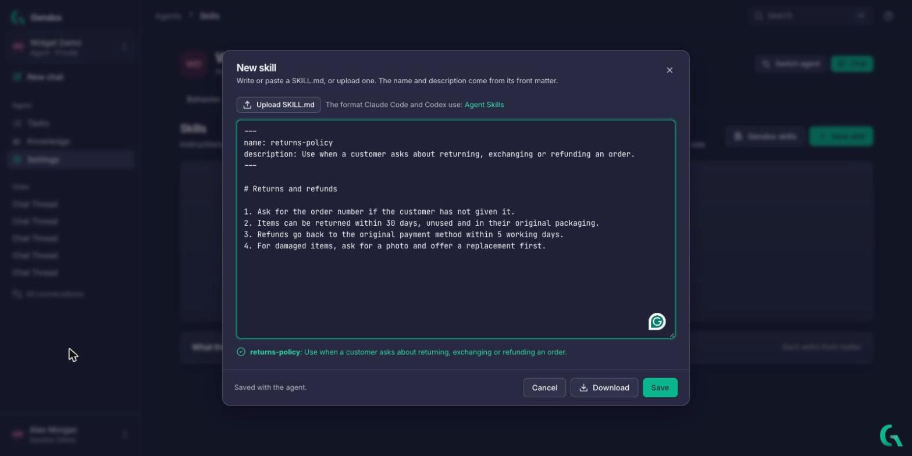
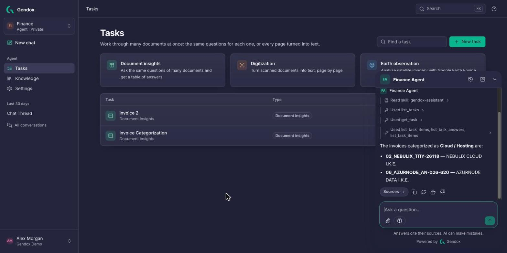

Gendox agents can use reusable skills, show responses as they arrive and continue a conversation with results returned by a website's tools. The same capabilities support the in-app Gendox assistant, which helps navigate the workspace and work with document tasks.

<!-- truncate -->

## Skills

**Skills** package instructions in `SKILL.md` files. The agent receives a catalog of its configured skills and can load a skill's full instructions when relevant to a request. This supports detailed procedures, such as a returns policy or troubleshooting guide, without including their full text in the main instructions for each conversation turn.

An agent can use a custom skill written or uploaded in its settings, or a ready-made skill from the Gendox library. [Read the agent configuration guide](/user-manual/configure-the-agent#skills).

## The Gendox assistant

The **Gendox assistant** runs the current agent inside the app, with the current page as context. With the assistant skill and its tools enabled, it can help find pages, answer questions from the agent's knowledge, read task results and create or run Document Insights and Digitization tasks, subject to the signed-in user's permissions.

For example, it can read an invoice categorization task's results to help identify which invoices relate to cloud hosting. Task runs use the organization's AI credits; the assistant's instructions call for confirmation before starting them.

## Answers that stream

Streaming chat displays response text incrementally in the app and website widget. The conversation can also show activity such as tool calls and skills loaded during a turn. This makes progress visible while a response is still being generated.

## Client tools that wait for your website

Client tools have two execution modes. A **Sync** tool pauses the agent's turn while the host website or app runs a handler and returns a result. For example, a site's handler could look up an order and return its status for the agent's next response.

An **Async** tool lets the agent continue without waiting for a result. This suits actions such as opening a page or filling a form. Custom tools require an implementation in the host website or application; defining a tool's name and inputs alone does not connect it to an order system or other service.

[Read about agent tools](/website-widget/agent-tool-use-and-website-tool-support).

## Knowledge search mode

Each agent has a configurable document search mode: **Always**, **When needed** or **Never**. These settings control whether document retrieval is required, left to the agent or disabled for ordinary chat search. They support different uses, from an assistant focused on a knowledge base to one that also handles requests without document retrieval.

Search activity and source passages are available in the conversation when retrieval is used. [Read the search settings guide](/user-manual/configure-the-agent#finding-answers).
