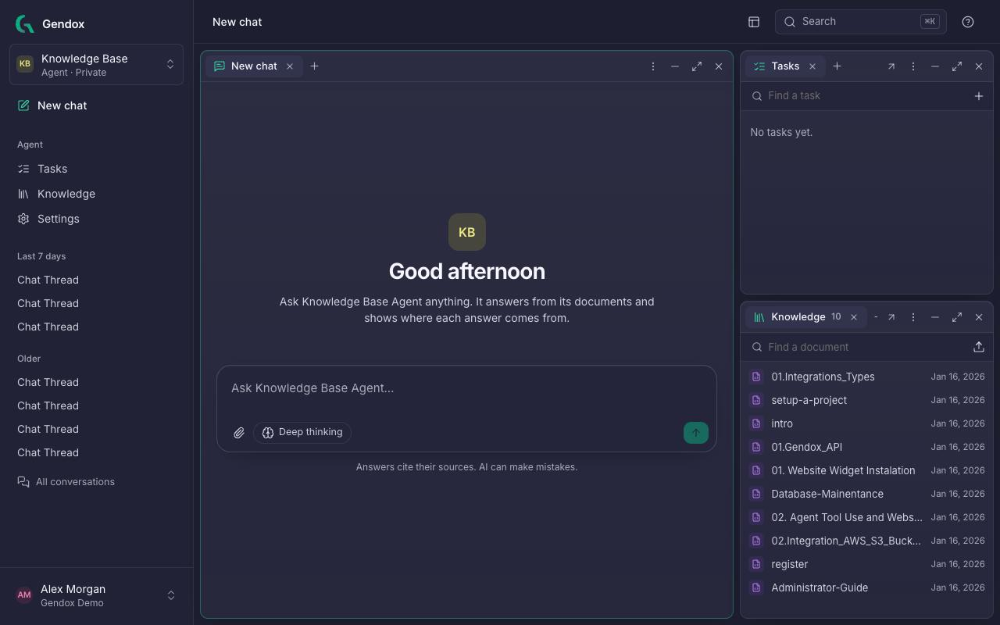
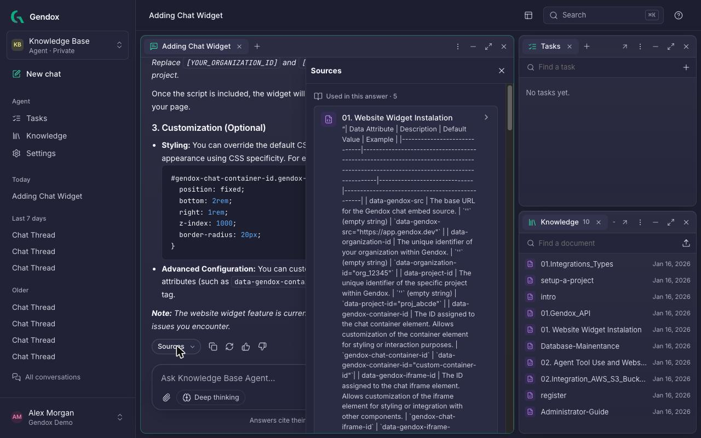
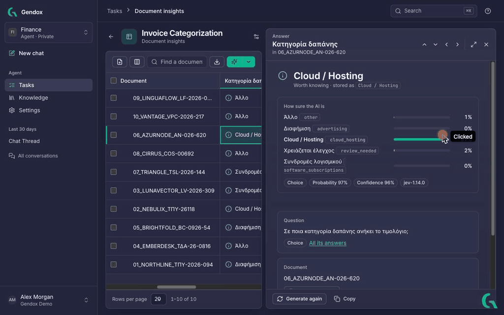

Gendox brings together document chat, batch analysis, digitization and agents with tools and skills. Its redesigned web app organizes these workflows around **agents**, with conversations, knowledge, tasks and settings accessible from the same workspace.

<!-- truncate -->

## One agent at a time

The agent switcher at the top of the sidebar selects the active agent. Its conversations, **Tasks**, **Knowledge** and **Settings** appear below. The agent home supports side-by-side windows for chat, tasks and documents, with tabs and full-page views for more focused work.

**Search**, available with **⌘K / Ctrl+K**, helps find pages, agents and matching passages in the active agent's documents. Document search uses meaning as well as document titles. [Explore the workspace](/user-manual/workspace-tour).

## Guided setup for an organization and its first agent

A guided flow helps a new user create an organization, name an agent and add its first knowledge. Options include uploading files, importing website content, connecting WordPress and writing a document in Gendox. Documents become available for retrieval after processing completes.

## Agent settings in six tabs

Agent settings are grouped into **Behavior**, **Tools**, **Skills**, **Deploy**, **Members** and **General**. **Behavior** brings together instructions, model selection, thinking effort and document search settings. The **Try it** panel provides a conversation with the agent using its saved configuration.

**Deploy** groups public or private access, the website widget's snippet and appearance controls, a live preview, and information about WordPress and API access. [Read the settings guide](/user-manual/configure-the-agent).

## Answers you can check

When an answer uses document retrieval, **Sources** provides access to the passages associated with it. The panel separates passages used in the answer from other search matches, and a source opens the document at the relevant passage. Answers produced without document retrieval may have no sources.

## Reviewing task results beside the document list

**Document Insights** and **Digitization** pair their document tables with readers that open alongside them. Insights supports moving between answers, reviewing explanations and document summaries, and checking task instructions. Digitization provides a page-by-page view of extracted text or JSON, with rendered and source views.

These views keep generated results accessible for review alongside the documents and instructions used to produce them. The [Document Insights](/document-insights/document-insights) and [Digitization](/document-digitization/document-digitization) guides describe the workflows in detail.

## Knowledge and organization controls

- **Knowledge** includes website imports with page selection and a configurable refresh schedule.
- **Organization settings** groups members, roles, API keys, model provider keys, connected services and plan information.
- **Theme** supports light, dark and device preferences.
- The updated [user manual](/) covers setup, chat, knowledge, tasks and deployment.
