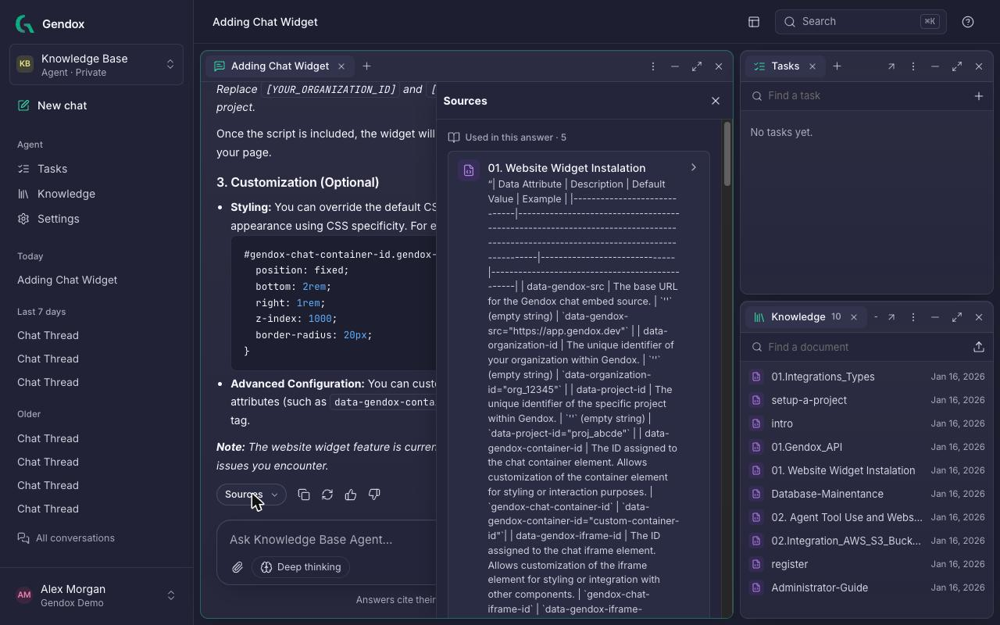
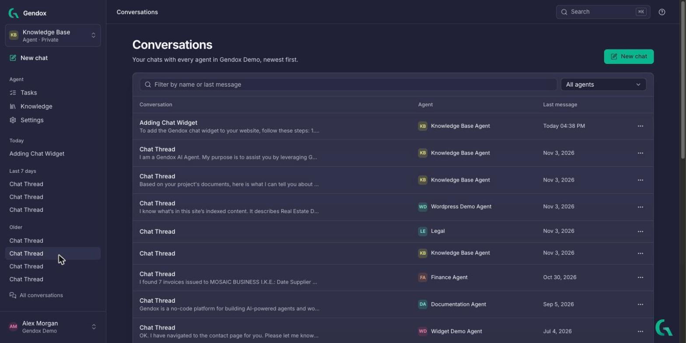

# Chat with an agent

import chatDemo from './img/v2/chat-ask-and-sources.gif';

The agent answers from its [knowledge](./knowledge.md) and shows the passages each answer is based on.

## Quick demo

---

## Ask a question

1. Click **New chat** in the sidebar (or the **Chat** button on any agent page).
2. Type your question in the message box. **Enter** sends it, **Shift+Enter** starts a new line.
3. The answer appears as it is written. While the agent works you may see steps such as *Searching Support Assistant's knowledge*, *Read skill: …* or *Used advanced_search*. Click a step to see its details.

The conversation gets a name from its first question, and appears in the sidebar under **Today**.

### In the message box

| Control | What it does |
|---|---|
| 📎 **Attach files or images** | Adds files to this question only. They are not added to the agent's knowledge. |
| **Deep thinking** | Slower, more thorough: the agent plans, searches several times and checks its answer. Use it for hard questions. |

---

## Read the sources

Under each answer, click **Sources**. The panel lists the passages **Used in this answer**, with the document each one comes from. Click a document to open it at that passage.

Passages the agent found but did not use are listed separately, so you can see what else matched.

> If an answer has no sources, the agent answered without its documents. You can make it always search them: [Configure the agent → Finding answers](./configure-the-agent.md#finding-answers).

### Other actions on an answer

| Button | What it does |
|---|---|
| **Copy** | Copies the answer as text. |
| **Ask again** | Generates a new answer to the same question. |
| 👍 **Good answer** / 👎 **Bad answer** | Records your feedback on the answer. |

---

## Conversations

- Your recent conversations are in the sidebar, grouped by date. Click one to continue it.
- **All conversations** lists every conversation you had with every agent of the organization, newest first. Filter by name or last message, or by agent.
- The **⋯** menu of a conversation lets you **rename** or **delete** it.

---

## Chat in other places

The same agent can answer:

- **On every page of the app**, through the [Gendox assistant](./workspace-tour.md#gendox-assistant).
- **In the Try it panel** of the agent's Behavior settings, to test changes before visitors see them ([Configure the agent](./configure-the-agent.md#behavior)).
- **On your website**, through the chat widget or the WordPress plugin ([Deploy](./configure-the-agent.md#deploy)).
- **From your own app**, through the API ([Gendox API](../02-api/01-gendox-api.md)).
