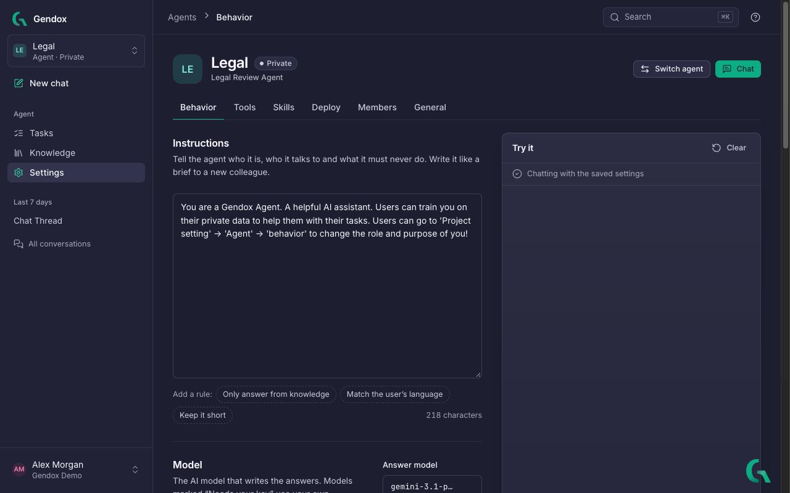
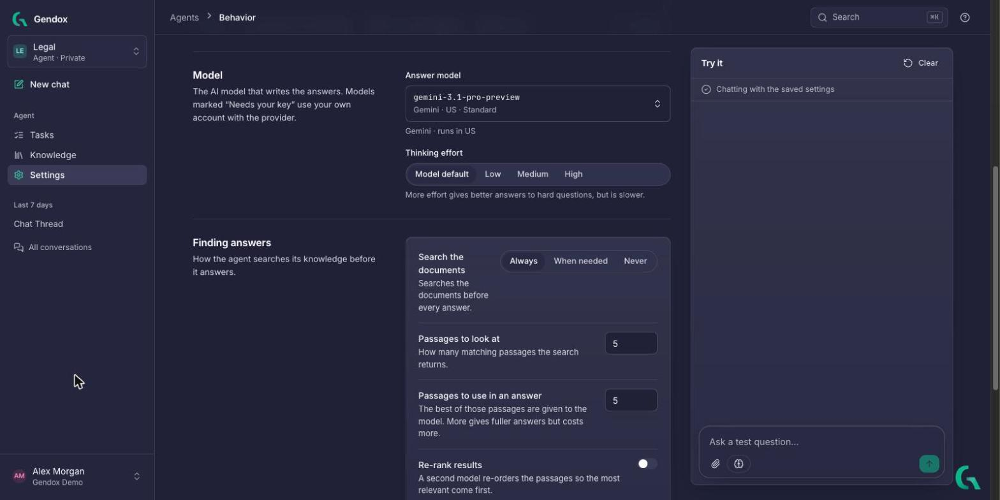
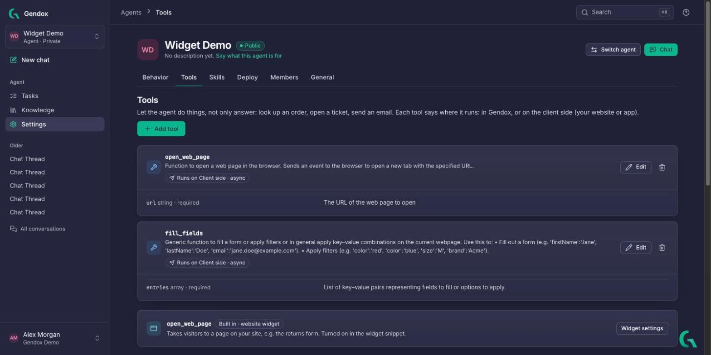
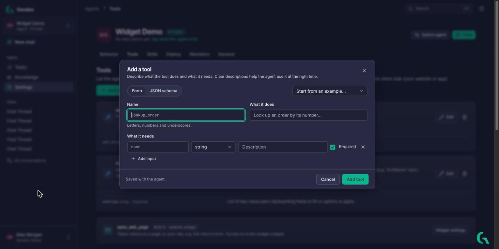
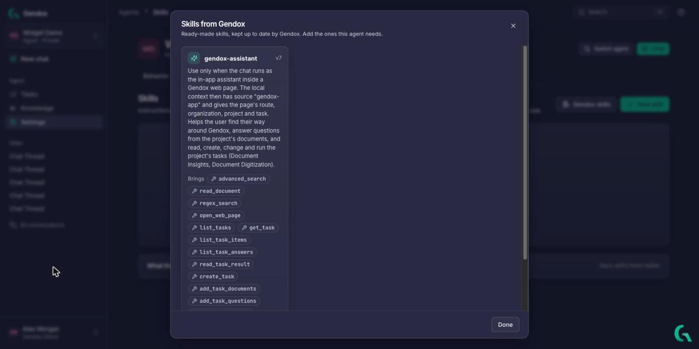
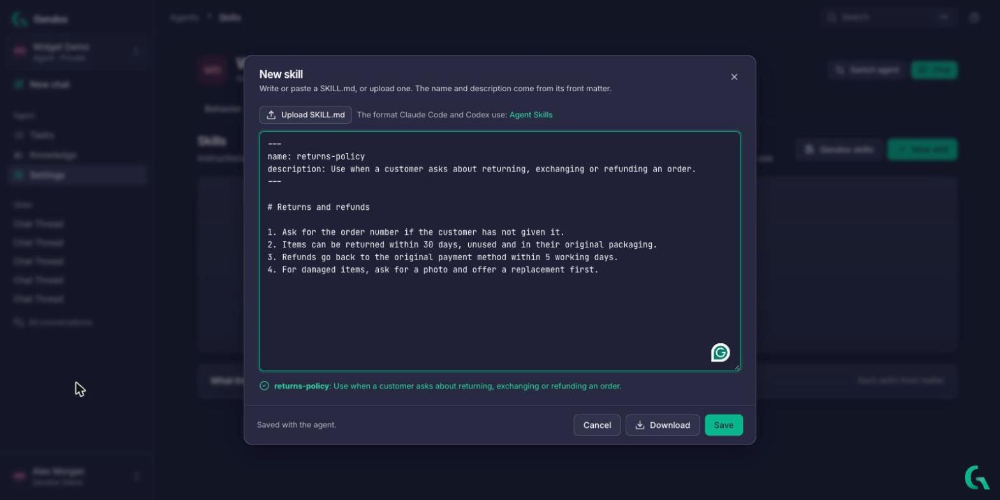
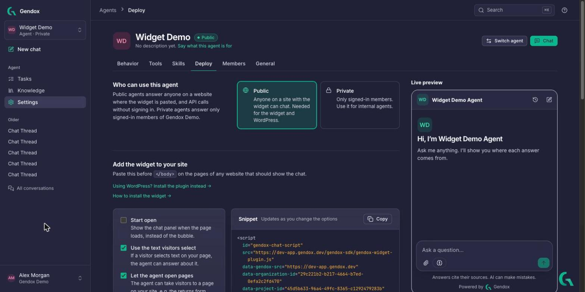
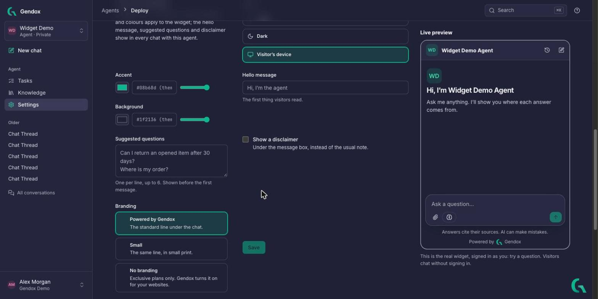
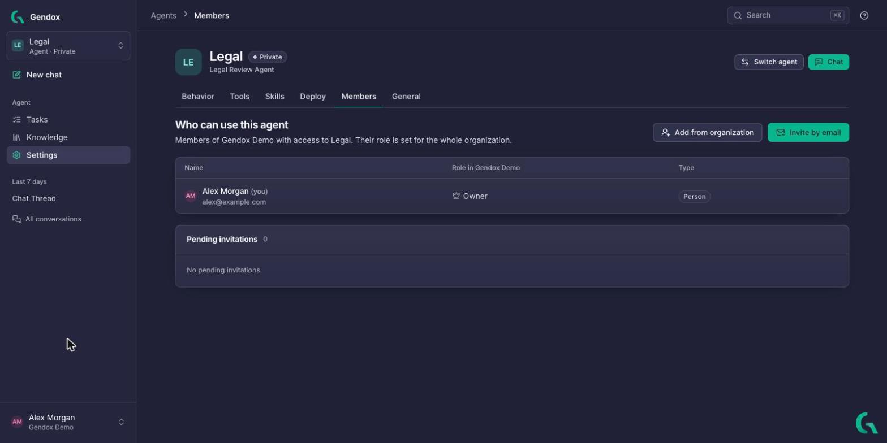
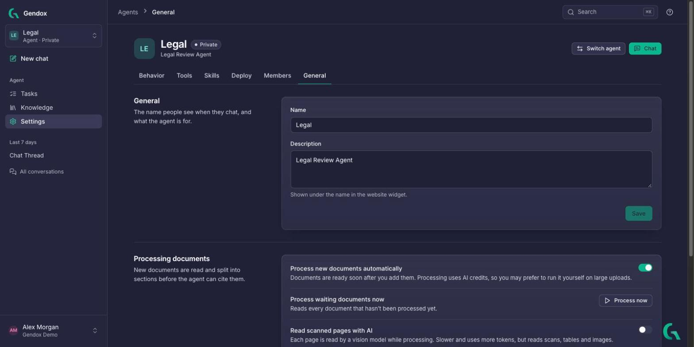

# Configure the agent

Open **Settings** in the sidebar. An agent's settings are in six tabs:

| Tab | What you set there |
|---|---|
| [Behavior](#behavior) | Instructions, model, how it searches its knowledge, safety. Test it in **Try it**. |
| [Tools](#tools) | Actions the agent can take, in Gendox or on your website or app. |
| [Skills](#skills) | Instructions the agent reads only when a question needs them. |
| [Deploy](#deploy) | Public or private, the website widget, its look, the API. |
| [Members](#members) | Who can use the agent. |
| [General](#general) | Name, description, document processing, deleting the agent. |

**Switch agent** (top right) changes which agent you are configuring. **Chat** opens a conversation with it.

You need the **Admin** or **Editor** role to change an agent ([roles](./invite-user.md#roles)).

---

## Behavior



### Instructions

Tell the agent who it is, who it talks to and what it must never do. Write it like a brief to a new colleague. For example:

```text
You are the support assistant of Acme, an online shop.
You talk to customers on our website.
Answer only from the documents. If they don't have the answer, say so and give the support email.
Never promise refunds or delivery dates.
Answer in the customer's language, in at most three short paragraphs.
```

The **Add a rule** buttons add common rules in one click: **Only answer from knowledge**, **Match the user's language**, **Keep it short**.

### Model



- **Answer model**: the AI model that writes the answers. Each entry shows its provider, where it runs and its tier. Models marked *Needs your key* use your own account with the provider; add the key in [Model providers](./organization-and-account.md#model-providers).
- **Thinking effort**: **Model default**, **Low**, **Medium** or **High**. More effort gives better answers to hard questions, but is slower.

### Finding answers

How the agent searches its knowledge before it answers.

| Setting | Options and meaning |
|---|---|
| **Search the documents** | **Always**: searches before every answer. **When needed**: the agent decides if a question needs the documents. **Never**: answers without searching. |
| **Passages to look at** | How many matching passages the search returns. |
| **Passages to use in an answer** | The best of those passages are given to the model. More gives fuller answers but costs more. |
| **Re-rank results** | A second model re-orders the passages so the most relevant come first. |

> Use **Always** for an agent that must stay close to your documents, such as customer support. Use **When needed** for an assistant that also chats generally.

### Safety

**Moderation check**: every question is checked first, and questions flagged as harmful get a polite refusal instead of an answer.

### Advanced settings

Answer length, creativity (temperature) and the model used to search the knowledge.

### Try it

The panel on the right chats with the agent **with its saved settings**. Change something, save, and ask the same question again to compare. **Clear** starts over.

---

## Tools

Tools let the agent **do things**, not only answer: look up an order, open a ticket, fill a form on your page. Each tool says where it runs.



| Runs | How it works | Examples |
|---|---|---|
| **In Gendox** | Built into Gendox. The agent gets the result straight away. | `advanced_search`, `read_document`, `regex_search`, `summarize`, `extract_relevant_sections`, `diff_documents` |
| **On the client side · async** | Your website or app acts on the call. The agent is told it was done and carries on. | `open_web_page`, `fill_fields` |
| **On the client side · sync** | Your website or app runs it and sends the result back. The agent waits, then answers with it. | `lookup_order`, `get_cart` |

### Add a tool

1. Click **Add tool**.
2. Fill in the **Form**, or paste a **JSON schema**. **Start from an example** fills in a ready-made tool.
   - **Name**: letters, numbers and underscores, for example `lookup_order`.
   - **What it does**: when the agent should use it. Clear descriptions help the agent use it at the right time.
   - **What it needs**: the inputs, each with a name, a type, a description and whether it is required.
3. Click **Add tool**.



A client-side tool also needs code on your website or app that runs it. The Tools tab shows the snippet; see [Agent tool use](../03-website-widget/02-agent-tool-use-and-website-tool-support.md) for the details.

The built-in **open_web_page** tool of the website widget lets the agent take visitors to a page of your site. It is turned on in the widget snippet ([Deploy](#deploy)).

---

## Skills

A **skill** is a set of instructions the agent reads **only when a question needs it**. The agent always sees each skill's name and description; it reads the rest when relevant. This keeps the instructions short while the agent can still follow detailed procedures.

Each skill is one `SKILL.md` file, the same format Claude Code and Codex use ([Agent Skills](https://agentskills.io)).

- **Gendox skills** adds a ready-made skill kept up to date by Gendox. For example **gendox-assistant** lets the agent find its way around Gendox and work with tasks; it brings its own tools.
- **New skill** writes your own, or uploads a `SKILL.md`.



A skill starts with front matter: a **name** and a **description** that says *when* to use it. The body holds the instructions:

```markdown
---
name: returns-policy
description: Use when a customer asks about returning, exchanging or refunding an order.
---

# Returns and refunds

1. Ask for the order number if the customer has not given it.
2. Items can be returned within 30 days, unused and in their original packaging.
3. Refunds go back to the original payment method within 5 working days.
4. For damaged items, ask for a photo and offer a replacement first.
```



The editor checks the front matter as you type. **Download** saves the file, **Save** adds it to the agent.

---

## Deploy



### Who can use this agent

| Option | Who can chat |
|---|---|
| **Public** | Anyone on a website where the widget is pasted, and API calls without signing in. Needed for the widget and WordPress. |
| **Private** | Only signed-in members of your organization. Use it for internal agents. |

### Add the widget to your site

1. Set the agent to **Public**.
2. Choose the options:
   - **Start open**: show the chat panel when the page loads, instead of the bubble.
   - **Use the text visitors select**: the agent can answer about text the visitor selected on your page.
   - **Let the agent open pages**: the agent can take visitors to a page on your site.
   - **Continue a conversation for** 30 minutes, 1 day or 7 days. After that, a returning visitor starts a new conversation.
3. Click **Copy** next to the **Snippet** and paste it before `</body>` on your pages.

The **Live preview** on the right is the real widget, signed in as you: try a question.

Using WordPress? Install the plugin instead: see [WordPress plugin](../03-website-widget/04-wordpress-plugin.md). Developers: see [Website widget](../03-website-widget/01-website-widget-installation.md).

### Look and branding



- **Theme**: Light, Dark, or the visitor's device.
- **Accent** and **Background** colours, with opacity.
- **Hello message**: the first thing visitors read.
- **Suggested questions**: one per line, up to 6, shown before the first message.
- **Show a disclaimer** under the message box, instead of the usual note.
- **Branding**: *Powered by Gendox*, the same line in small print, or none (on plans that allow it).

Click **Save**. The hello message, suggested questions and disclaimer show in every chat with this agent.

### Use it from your code

Send questions to the agent from your own app with an [API key](./organization-and-account.md#api-keys). Answers come back with their sources. The Deploy tab shows a ready `curl` example; see [Gendox API](../02-api/01-gendox-api.md).

---

## Members

Lists who can use the agent and their **role in the organization**.



- **Add from organization** gives an existing member access to this agent.
- **Invite by email** invites someone new. See [Invite people](./invite-user.md).
- **Pending invitations** shows invitations not accepted yet.

---

## General



- **Name** and **Description**: the name people see when they chat, and what the agent is for (shown under the name in the widget).
- **Process new documents automatically**: documents are ready soon after you add them. Processing uses AI credits, so you may turn it off and run it yourself on large uploads.
- **Process waiting documents now** → **Process now**: reads every document that hasn't been processed yet.
- **Read scanned pages with AI**: each page is read by a vision model while processing. Slower and uses more tokens, but reads scans, tables and images.
- **Danger zone → Delete agent**: removes its knowledge, conversations and tasks; members lose access and the widget stops working. This can't be undone.
