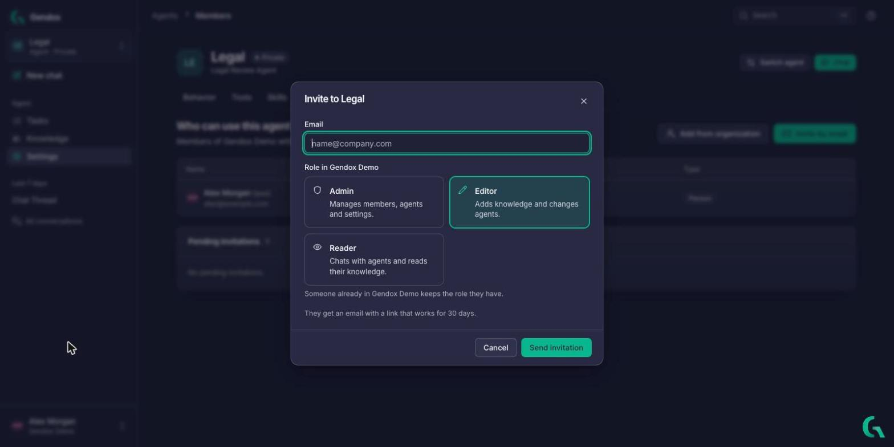
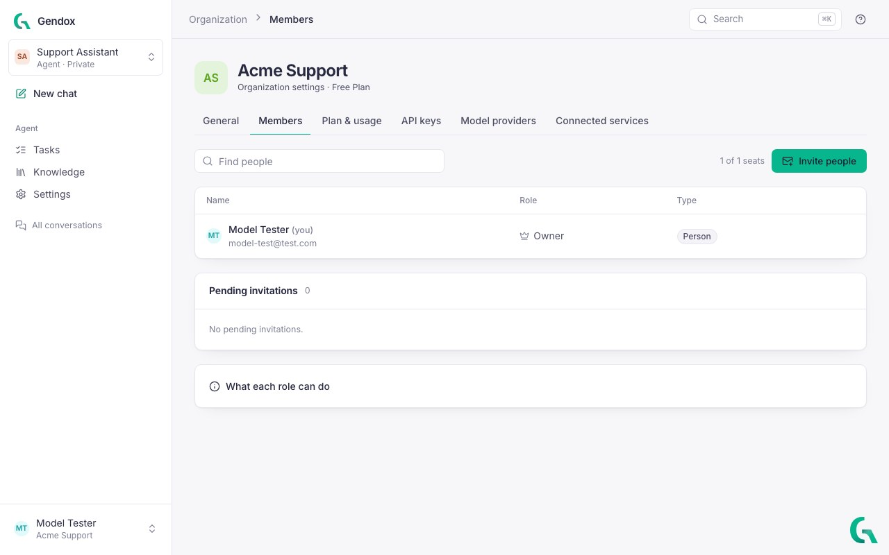

# Invite people

People work in Gendox as **members of an organization**. Each member has one **role** in the organization, and access to **some or all of its agents**.

## Roles

| Role | What it allows |
|---|---|
| **Owner** | Everything, including billing and deleting the organization. |
| **Admin** | Manages members, agents and settings. |
| **Editor** | Adds knowledge and changes agents. |
| **Reader** | Chats with agents and reads their knowledge. |

You can give a role up to your own: an Editor can invite Editors and Readers, an Admin can also invite Admins.

---

## Invite someone to one agent

1. Open the agent, then **Settings** → **Members**.
2. Click **Invite by email**.
3. Enter the **Email** and choose the **Role in** the organization: **Admin**, **Editor** or **Reader**.
4. Click **Send invitation**.

They get an email with a link that works for 30 days. Someone already in the organization keeps the role they have and just gets access to this agent.

To give an **existing member** access to the agent, click **Add from organization** instead.

---

## Invite people to the organization

1. Open the account menu at the bottom of the sidebar and click **Members** (or search *Invite people* with ⌘K / Ctrl+K).
2. Click **Invite people**.
3. Enter one or more **Emails**, separated by commas.
4. Choose their **Role** and the agent they **Start with**. You can add more agents after they join.
5. Click **Send invitations**.

The Members page also shows how many **seats** your plan has and how many are used. Each member takes one seat.

---

## Pending invitations

Invitations not accepted yet are listed under **Pending invitations**, with a **Pending** badge. Use **Copy link** to send the invitation link another way, for example in a chat message.

---

## What the invitee does

The invitee clicks **Accept Invitation** in the email, then signs in, or creates an account with the same email address. See [Register and sign in](./register.md#accept-an-invitation).

---

## Remove someone

On the organization's **Members** page, open the member's menu and remove them. They lose access to every agent in the organization; their documents and conversations stay.
