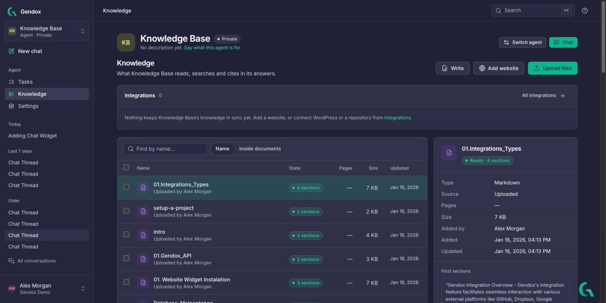
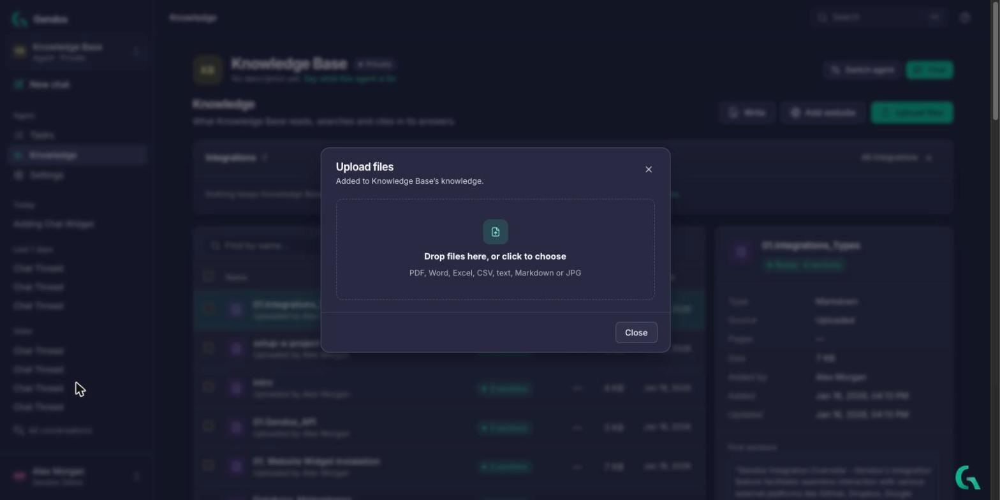
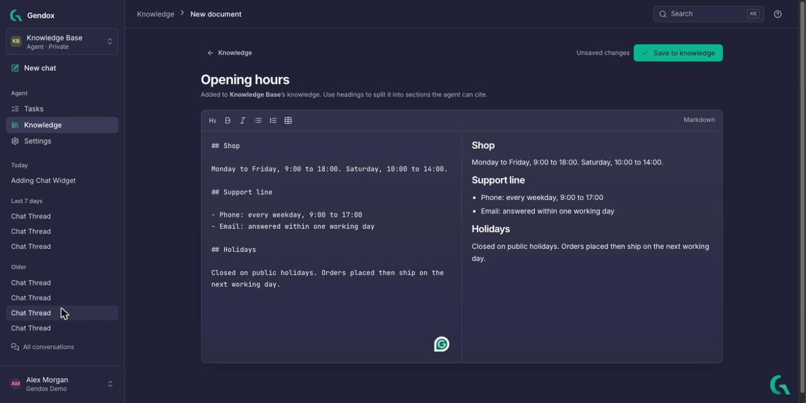
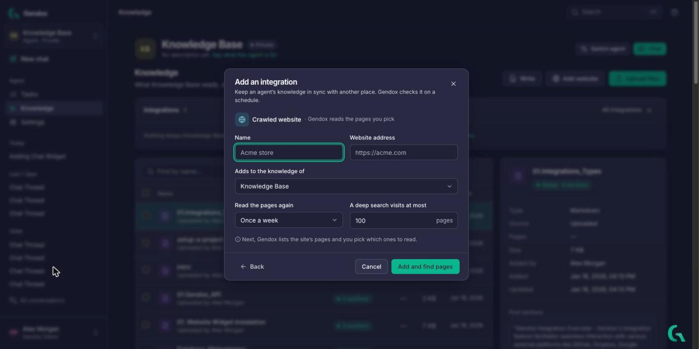
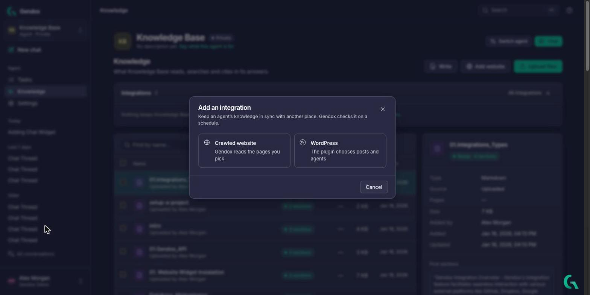

# Knowledge

An agent's **knowledge** is the set of documents it searches and cites when it answers. Open it from **Knowledge** in the sidebar.

The page shows:

- the **Integrations** that keep this knowledge in sync with a website, WordPress or a repository,
- the list of documents, with their **State**, **Pages**, **Size** and last update,
- on the right, the details of the selected document: type, source, who added it, and its first sections. **Open** reads the whole document, **Ask about it** starts a chat about it, **Delete** removes it.

---

## Add knowledge

There are four ways, all from the buttons at the top right of the page.

### Upload files

1. Click **Upload files**.
2. Drop files in the window, or click to choose them.
3. Each file shows **Uploaded** when it is done. Click **Close**.

Supported: PDF, Word, Excel, CSV, plain text, Markdown and JPG.

### Write a document

Click **Write** to type or paste a document directly in Gendox. The editor uses Markdown, with a live **Preview**. **Use headings**: each heading starts a section, and sections are what the agent cites. Click **Save to knowledge** when done.

### Read a website

1. Click **Add website**.
2. Give it a **Name** and the **Website address**.
3. Choose **Read the pages again** (how often Gendox checks the site for changes) and how many pages a deep search visits at most.
4. Click **Add and find pages**. Gendox lists the site's pages and you pick which ones to read.

### Connect WordPress

From **Add website**, click **Back** to see all integration types, then **WordPress**. The Gendox WordPress plugin chooses which posts and pages each agent gets. See [WordPress plugin](../03-website-widget/04-wordpress-plugin.md).

All integrations of the organization are listed under **Integrations** in the account menu. See [Organization and account](./organization-and-account.md#integrations).

---

## Processing and document states

Before the agent can cite a document, Gendox reads it and splits it into **sections**. This is called *processing*.

| State | Meaning |
|---|---|
| **Processing** / **Not processed yet** | The document is in the knowledge but has no sections yet. Answers can't cite it. |
| **N sections** (details: **Ready · N sections**) | Processed. The agent can find and cite it. |

When documents are waiting, the page offers **Process now** to start processing at once.

Processing runs on its own when **Process new documents automatically** is on (the default for new agents). You can change this, process waiting documents at once, or turn on **Read scanned pages with AI** for scans, tables and images in [Configure the agent → General](./configure-the-agent.md#general).

---

## Find a document

- **Name** searches the document titles.
- **Inside documents** searches their content, by meaning.
- [Search (⌘K / Ctrl+K)](./workspace-tour.md#search) does the same from anywhere in the app.

---

## Good practices

- **One topic per document**, with clear headings. Sections then match questions well.
- Keep documents **current**: delete or replace outdated ones, so the agent doesn't cite them.
- For scanned PDFs, turn on **Read scanned pages with AI**, or turn the scans into text with a [Digitization task](../08-document-digitization/01-document-digitization.md) first.
- After adding documents, ask the agent a question in **Try it** ([Behavior](./configure-the-agent.md#behavior)) and check its **Sources**.
