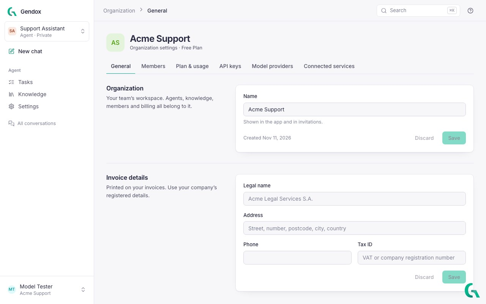
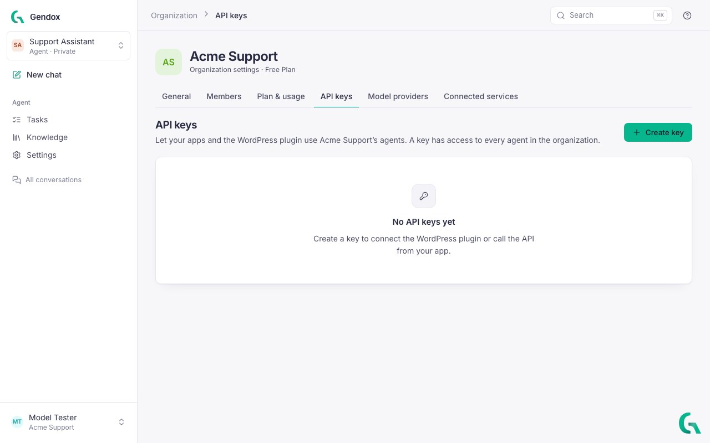
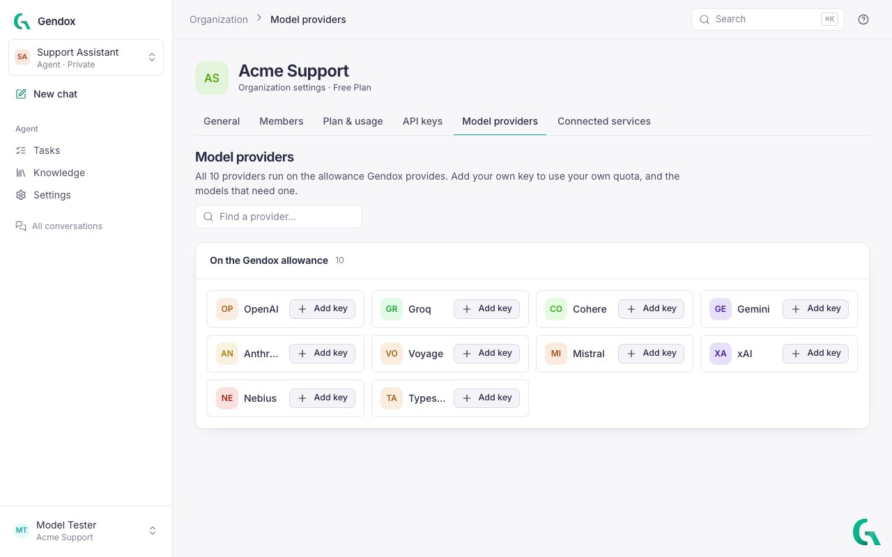
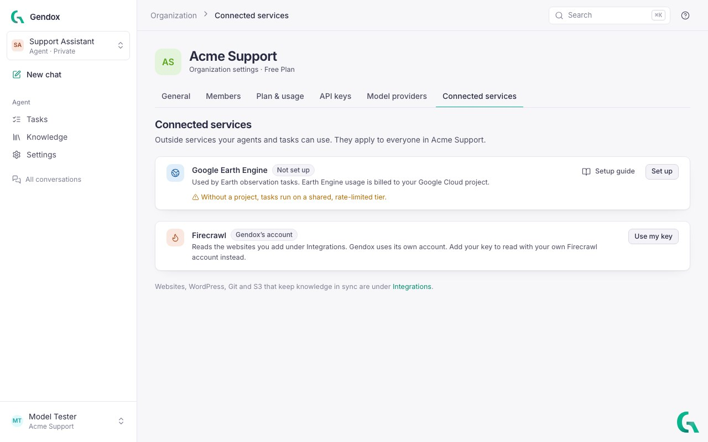
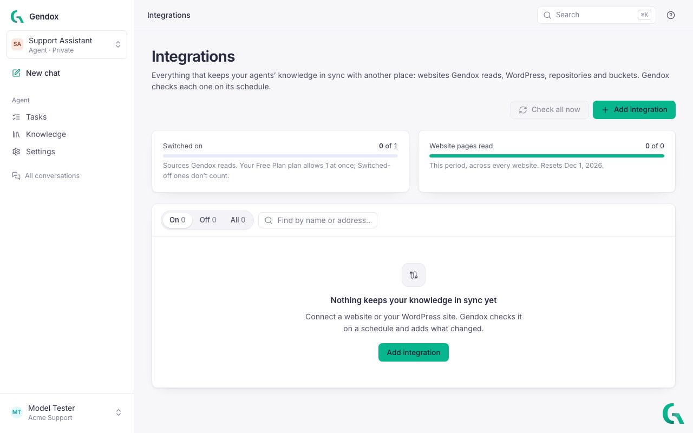
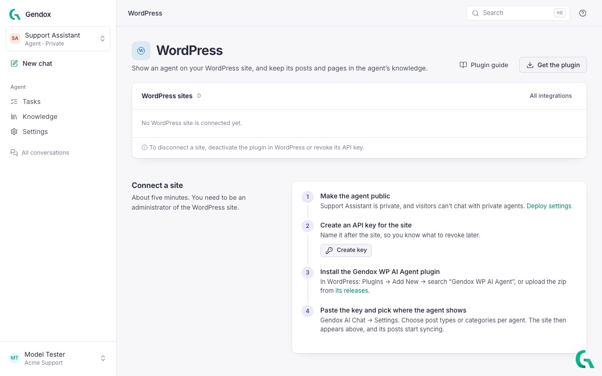
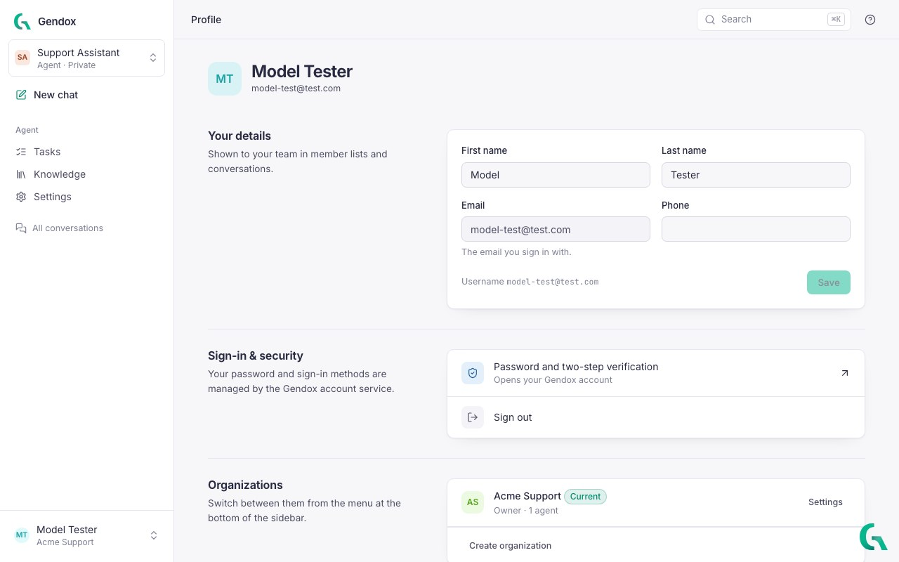

# Organization and account

Everything that belongs to the whole team is in the **organization**. Open it from the account menu at the bottom of the sidebar: **Organization settings**. The settings have six tabs:

| Tab | What it holds |
|---|---|
| [General](#general) | Name, invoice details, deleting the organization |
| [Members](#members) | People, their roles, invitations, seats |
| [Plan & usage](#plan--usage) | Your plan, what you used this period, its limits |
| [API keys](#api-keys) | Keys for your apps and the WordPress plugin |
| [Model providers](#model-providers) | Your own keys for AI providers |
| [Connected services](#connected-services) | Google Earth Engine, Firecrawl |

Most organization settings need the **Owner** or **Admin** role.

---

## General

- **Name**: shown in the app and in invitations.
- **Invoice details**: legal name, address, phone and tax ID printed on your invoices.
- **Danger zone → Delete organization**: deletes all agents, knowledge, conversations and tasks; every member loses access. Only owners can do this.

---

## Members

See [Invite people](./invite-user.md) for roles, invitations and seats.

---

## Plan & usage

Shows your current plan, and how much of it you used this period: seats, agents, websites, integrations, website pages read, messages and upload size. **Compare plans** shows what each plan includes. Billing, invoices and payment methods are managed on gendox.dev, through **Manage subscription**.

---

## API keys

API keys let your own apps, and the WordPress plugin, use the organization's agents. **A key has access to every agent in the organization**, so keep it secret.

1. Click **Create key** and name it after where it will be used (for example, the website's address), so you know what to revoke later.
2. Copy the key when it is shown.
3. To stop a key working, click **Revoke**.

See [Gendox API](../02-api/01-gendox-api.md) for how to call an agent with a key.

---

## Model providers

By default, every provider (OpenAI, Anthropic, Gemini, Mistral, Groq, Cohere, Voyage, xAI and others) runs on the allowance Gendox provides. **Add key** to use your own account with a provider instead: usage is then billed by the provider to you, and models marked *Needs your key* become available to your agents.

**Replace** or **Remove** a key at any time. Gendox shows only its last characters.

---

## Connected services

Outside services your agents and tasks can use:

- **Google Earth Engine**: used by [Earth observation](../06-earth-observation/02-user-guide.md) tasks. Set up your own Google Cloud project to bill Earth Engine usage to it ([GEE project setup](../06-earth-observation/05-gee-project-setup.md)); without one, tasks run on a shared, rate-limited tier.
- **Firecrawl**: reads the websites you add as knowledge. Gendox uses its own account; **Use my key** reads with your own Firecrawl account instead.

---

## Integrations

**Integrations** (account menu) lists everything that keeps your agents' knowledge in sync with another place: websites Gendox reads, WordPress sites, repositories and buckets. Gendox checks each one on its schedule.

- **Add integration**: a crawled website or WordPress ([Knowledge](./knowledge.md#read-a-website)).
- **Check all now**: checks every integration at once instead of waiting for its schedule.
- Switch an integration **on** or **off**. Switched-off integrations don't count against your plan.

Git repository and AWS S3 integrations are described in [Import Data Integrations](../04-integrations/01-integrations-types.md).

---

## WordPress

**WordPress** (account menu) connects WordPress sites to your agents. It walks you through the four steps: make the agent public, create an API key for the site, install the **Gendox WP AI Agent** plugin, and paste the key in the plugin's settings. Connected sites are listed at the top, with when Gendox last checked them.

Full guide: [WordPress plugin](../03-website-widget/04-wordpress-plugin.md).

---

## Your profile

Open **Profile** from the account menu.

- **Your details**: first name, last name and phone, shown to your team in member lists and conversations.
- **Sign-in & security**: **Password and two-step verification** opens your Gendox account, where you change your password or turn on two-step verification.
- **Organizations**: the organizations you belong to and your role in each. **Create organization** starts a new one.
- **Appearance**: Light, Dark or Match system. Saved on this device.
- **Delete account**: you leave every organization and are signed out. If you own an organization, first make someone else an owner, or delete it.

