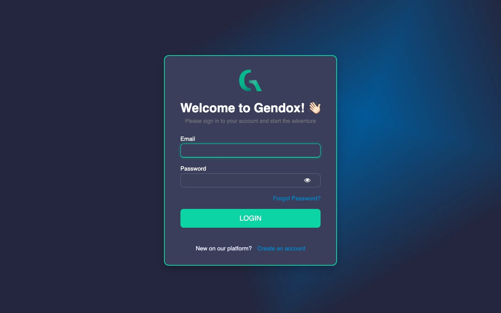
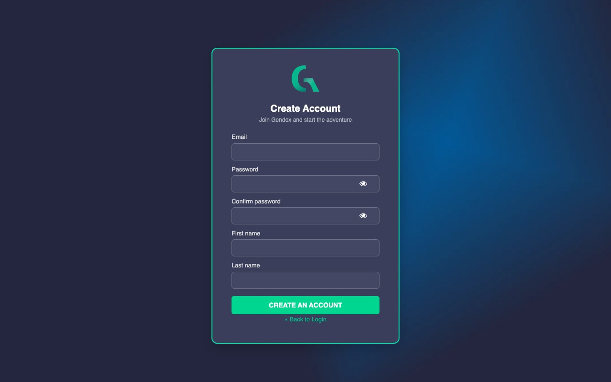
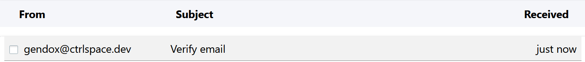
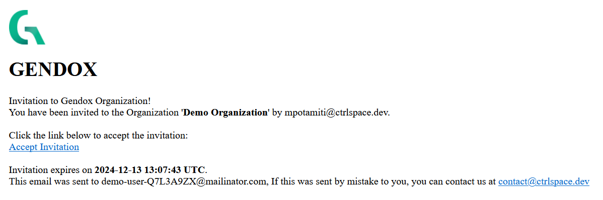

# Register and sign in

You can join Gendox in two ways:

- **On your own**: create an account, then create your own organization and first agent.
- **By invitation**: someone in an existing organization invites you by email. You join their organization and can use the agents they gave you access to.

---

## Create an account

1. Open Gendox. You land on the sign-in page.
2. Click **Create an account**.

3. Fill in your **Email**, a **Password** (twice), your **First name** and **Last name**.
4. Submit the form.

5. Gendox sends you an email to verify your address. Open it and click the link.

After verifying, you are signed in. If you registered on your own, Gendox now asks you to name your organization: continue with [Create your first agent](./setup-a-project.md).

---

## Accept an invitation

When someone invites you, you receive an email with an **Accept Invitation** link. The link is valid for 30 days.

1. Click **Accept Invitation**.
2. If you don't have an account yet, click **Create an account** on the sign-in page and register with **the same email address the invitation was sent to**. Then verify your email.
3. If you already have an account, sign in.

You then see the organization you were invited to, with the agents you were given access to. If you belong to several organizations, switch between them from the account menu at the bottom of the sidebar (see [The workspace](./workspace-tour.md#account-menu)).

> An invitation gives access to **one agent**, or adds you to the organization with a role. To use more agents, ask an admin to add you to them (see [Invite people](./invite-user.md)).

---

## Sign in and out

- **Sign in**: enter your email and password on the sign-in page and click **Login**. **Forgot Password?** sends you a reset link.
- **Sign out**: open the account menu at the bottom of the sidebar and click **Sign out**.
- **Password and two-step verification**: open **Profile** from the account menu, then **Password and two-step verification**. See [Organization and account](./organization-and-account.md#your-profile).
