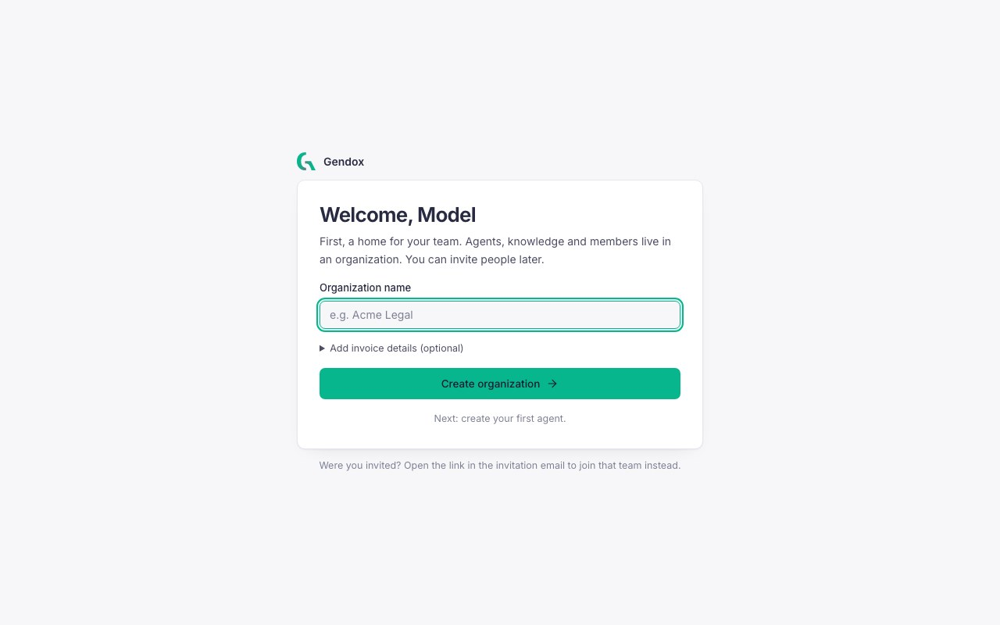
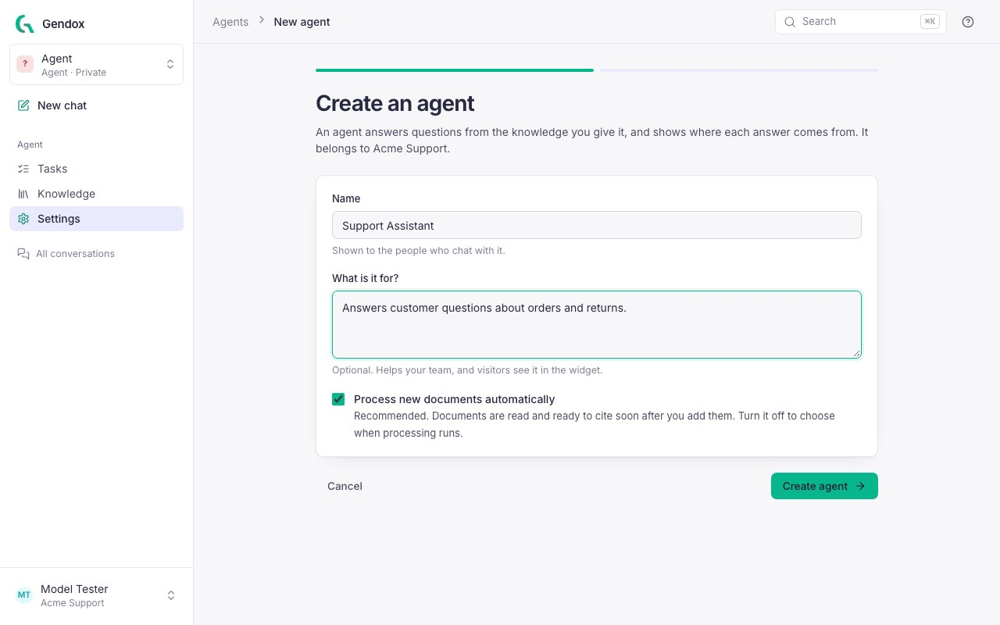
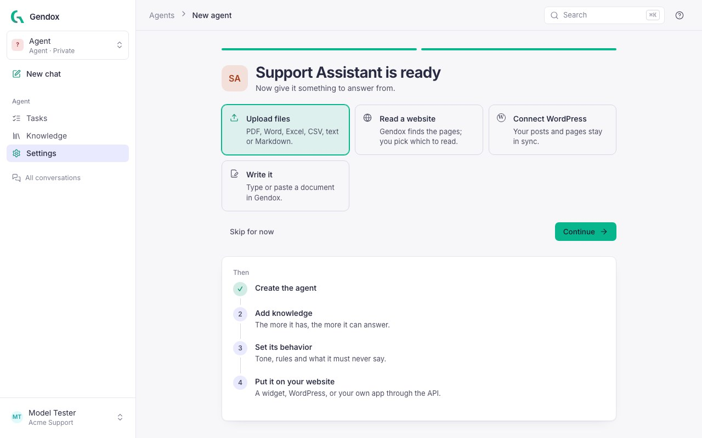
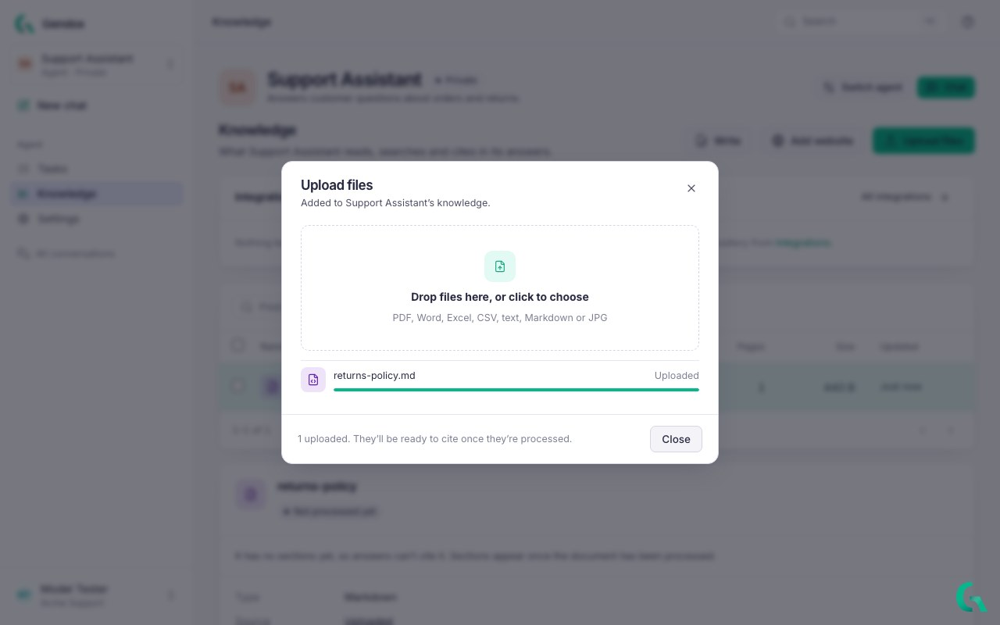

# Create your first agent

import onboardingDemo from './img/v2/onboarding.gif';

An **agent** is an AI assistant that answers from the knowledge you give it and shows where each answer comes from. Every agent belongs to an **organization**: your team's workspace, where members, agents and billing live.

This page takes you from your first sign-in to your first answer, in about two minutes.

## Quick demo

---

## 1. Name your organization

The first time you sign in, Gendox asks for an organization name. Use your company or team name; you can change it later.

1. Type the **Organization name**.
2. Optionally open **Add invoice details** to fill in your company's legal details.
3. Click **Create organization**.

> Were you invited by someone? Open the link in the invitation email instead. You then join their organization and skip this step. See [Register](./register.md).

---

## 2. Create the agent

1. **Name**: the name people see when they chat, for example *Support Assistant*.
2. **What is it for?** (optional): one sentence about its job. Visitors see it in the website widget.
3. **Process new documents automatically**: leave it on. Documents you add are then read and ready to cite within a short time.
4. Click **Create agent**.

---

## 3. Give it something to answer from

An agent answers only as well as its knowledge. Choose where its first knowledge comes from and click **Continue**:

| Choice | What happens |
|---|---|
| **Upload files** | Opens the upload window. PDF, Word, Excel, CSV, text, Markdown or JPG. |
| **Read a website** | Gendox lists the pages of a site and you pick which ones to read. |
| **Connect WordPress** | Your WordPress posts and pages stay in sync with the agent. |
| **Write it** | Type or paste a document directly in Gendox. |

You can also click **Skip for now** and add knowledge later from **Knowledge** in the sidebar.

When a file is uploaded, the window shows it as **Uploaded**. Close it: the document now shows **Processing** in the list, and turns **Ready** once it has been split into sections the agent can cite.

See [Knowledge](./knowledge.md) for every way to add and manage documents.

---

## 4. Ask your first question

Click **New chat** at the top of the sidebar, type a question and press **Enter**. The agent answers from its documents and lists its **Sources** under the answer.

See [Chat with an agent](./chat.md).

---

## What next

| To… | Read |
|---|---|
| Find your way around the app | [The workspace](./workspace-tour.md) |
| Change how the agent behaves, which model it uses, and its tools and skills | [Configure the agent](./configure-the-agent.md) |
| Put the agent on your website | [Configure the agent → Deploy](./configure-the-agent.md#deploy) and [Website Widget](../03-website-widget/01-website-widget-installation.md) |
| Ask the same questions of many documents | [Tasks](./tasks.md) |
| Invite your team | [Invite people](./invite-user.md) |
