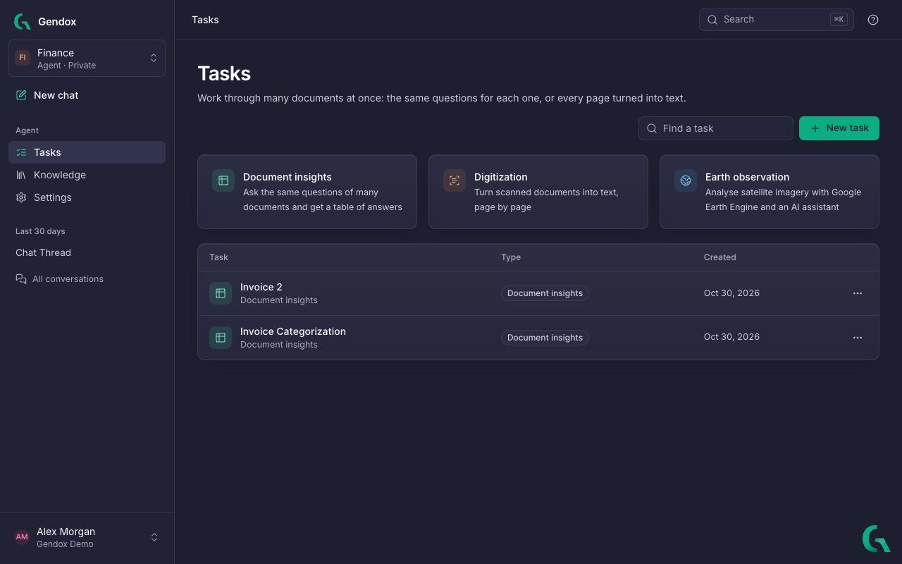
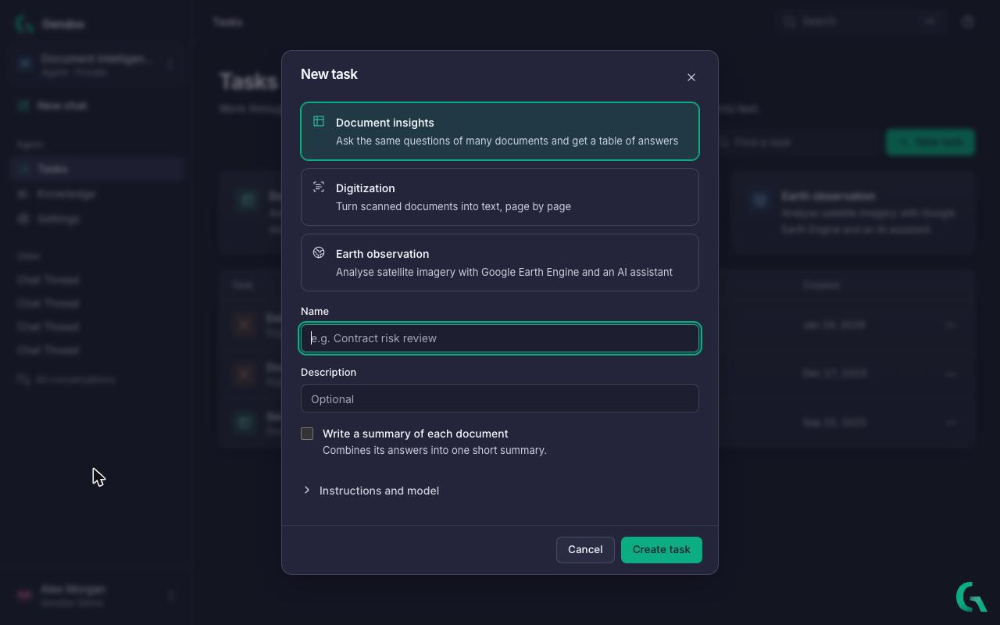
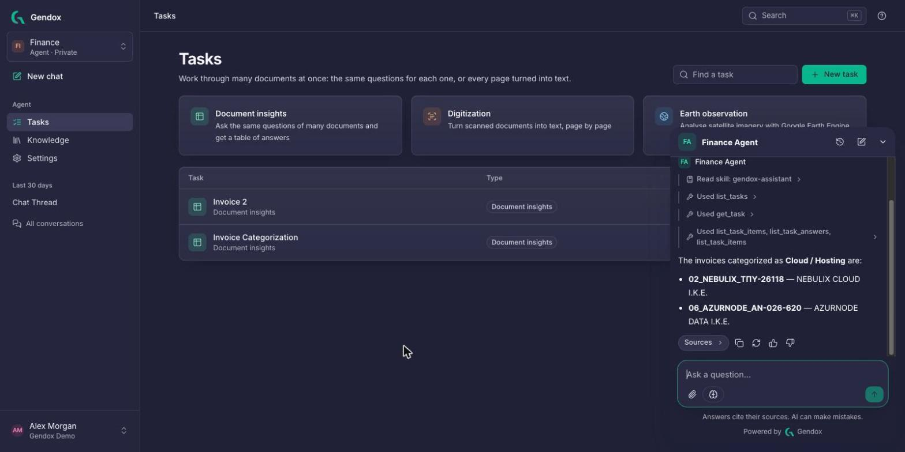

# Tasks

Chat answers one question at a time. A **task** does the same work for **many documents at once** and keeps the results in a table you can review and export. Open **Tasks** in the sidebar.

## Task types

| Type | Use it to | Result | Guide |
|---|---|---|---|
| **Document insights** | Ask the same questions of many documents, e.g. review 50 contracts or categorize 200 invoices. | A table: one row per document, one column per question, with a status flag on every answer. | [Document Insights](../07-document-insights/01-document-insights.md) |
| **Digitization** | Turn scanned documents, PDFs and office files into text, page by page, or into structured JSON. | The text (Markdown or JSON) of every page. | [Document Digitization](../08-document-digitization/01-document-digitization.md) |
| **Earth observation** | Analyse satellite imagery with Google Earth Engine and an AI assistant. | Map layers and analysis code. | [Earth Observation](../06-earth-observation/02-user-guide.md) |

---

## Create a task

1. Click **New task**, or one of the three task type cards.
2. Choose the type.
3. Give it a **Name** and, optionally, a **Description**.
4. Set the options of the type:
   - Document insights: **Write a summary of each document** combines each document's answers into one short summary.
   - Digitization: **Read each page from** *An image of the page* (best for scans, stamps, handwriting and tables) or *The text in the file* (faster for digital PDFs).
5. Optionally open **Instructions and model**:
   - **Extra instructions**: given to the AI for every document, e.g. *Quote the clause your answer comes from.*
   - **Model**: the agent's model by default, or another one for this task.
   - **Longest answer (tokens)**, **Creativity** and **Top P** for fine-tuning.
6. Click **Create task**.

You can change these later from the **Task settings** button (top right of a task).

---

## Run a task

Inside a task:

1. **Add documents**: upload new files, or pick documents already in the agent's knowledge.
2. Document insights only: **Add questions**.
3. Click **Generate missing** (Document insights) or **Digitize missing pages** (Digitization). Only empty cells or missing pages are processed; existing results are kept.

The arrow next to the button offers to **regenerate everything** (or the selected rows). This replaces existing results, including ones you have checked, and can't be undone.

Tasks run in the background: you can leave the page and come back. While a task runs, a progress bar shows **Generating answers** or **Digitizing**; click **Stop** to end it early. Stopping can take up to a minute.

> Running a task uses AI credits for every document (insights) or every page (digitization). Try it on two or three documents first: select them and click **Generate selected** / **Digitize selected**.

---

## Review and export

- Click a result to open it beside the table. Use the arrow keys to move between documents and answers.
- **CSV** exports results. In Document insights, the toolbar button exports the whole table and a document's panel exports that document. In Digitization, a document's panel exports its pages.

---

## Manage tasks

The **⋯** menu of a task in the list has:

- **Edit**: name, description and options.
- **Duplicate**: a copy of the task, e.g. to try other questions on the same documents.
- **Delete**: removes the task and its results.

---

## Let the assistant work with tasks

The [Gendox assistant](./workspace-tour.md#gendox-assistant) (the Gendox icon at the bottom right) can list your tasks, read their results, create tasks, add documents and questions, and run them. Ask in plain words, for example:

- *Which invoices in Invoice Categorization are Cloud / Hosting?*
- *Create a Document insights task called Lease review with the question "When does the lease end?"*
- *Which contracts in Contract Review have a major issue?*

The assistant says what it will change before it changes anything, and asks for confirmation before it runs a task, because running uses credits. It only generates **missing** results; to regenerate existing ones, use the generate menu on the task page.
