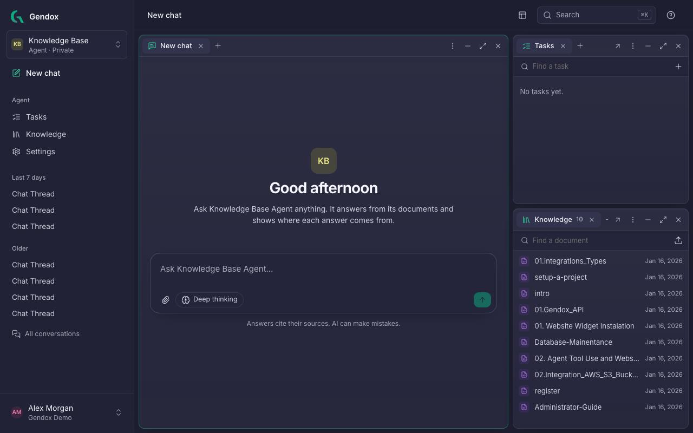
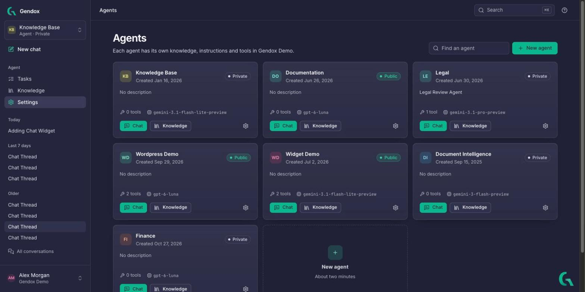
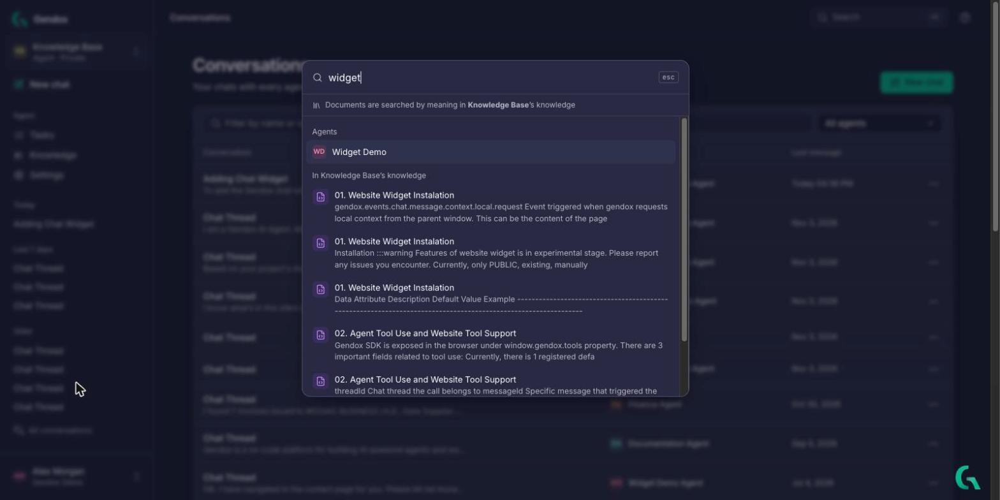
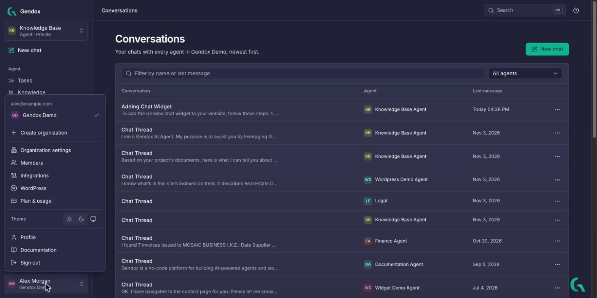

# The workspace

Gendox is organized around **agents**. You work with one agent at a time: the sidebar shows that agent's pages, and you switch agents from the top of the sidebar.

## Map of the app

| Where | What it is | Page |
|---|---|---|
| Sidebar → agent switcher (top) | Choose the agent you work with, see **All agents** or create a **New agent** | [Agents](#agents) |
| Sidebar → **New chat** | Start a conversation with the current agent | [Chat](./chat.md) |
| Sidebar → **Tasks** | Batch work on many documents: Document insights, Digitization, Earth observation | [Tasks](./tasks.md) |
| Sidebar → **Knowledge** | The documents the agent reads and cites | [Knowledge](./knowledge.md) |
| Sidebar → **Settings** | Behavior, Tools, Skills, Deploy, Members, General | [Configure the agent](./configure-the-agent.md) |
| Sidebar → recent chats, **All conversations** | Your past conversations | [Chat](./chat.md#conversations) |
| Sidebar → account menu (bottom) | Organizations, organization settings, members, integrations, plan, theme, profile, sign out | [Organization and account](./organization-and-account.md) |
| Top bar → **Search** (⌘K / Ctrl+K) | Jump to any page or agent, and search inside documents | [Search](#search) |
| Bottom-right Gendox icon | The Gendox assistant, available on every page | [Gendox assistant](#gendox-assistant) |

---

## Agent home

Clicking the Gendox logo, or an agent's **Chat** button, opens the agent home. It is a set of **windows** side by side: a chat, the agent's **Tasks** and its **Knowledge**.

Each window has controls in its title bar:

- **+** opens another tab in the same window, for example a second chat.
- **Open as a full page** (↗) opens the window's content as its own page.
- **Minimize**, **Maximize** and **Close** arrange the windows.
- The **Layout** button in the top bar lists the **Windows** you can show: **New chat**, **Tasks** and **Knowledge**.

---

## Agents

Open the agent switcher at the top of the sidebar to change agent. **All agents** lists every agent of the organization you have access to, with its visibility (**Public** or **Private**), its model and its number of tools.

From each card you can open **Chat**, **Knowledge** or the agent's settings (gear icon). **New agent** starts the same wizard as in [Create your first agent](./setup-a-project.md).

---

## Search

Click **Search** in the top bar or press **⌘K** (Mac) / **Ctrl+K** (Windows, Linux). Type to find:

- pages of the app (for example *API keys* or *Invite people*),
- agents by name,
- passages **inside the current agent's documents**. Documents are searched by meaning, not only by exact words.

Use the arrow keys and **Enter** to open a result, **Esc** to close.

---

## Account menu

The menu at the bottom of the sidebar shows your email and the organizations you belong to. Click an organization to switch to it. It also holds:

- **Create organization**
- **Organization settings**, **Members**, **Integrations**, **WordPress**, **Plan & usage**
- **Theme**: light, dark, or match your device
- **Profile**, **Documentation**, **Sign out**

> The screenshots in this manual show both the dark and the light theme. Everything works the same in both.

---

## Gendox assistant

The Gendox icon at the bottom right of every page opens the **Gendox assistant**: the current agent, running inside the app. It knows which page you are on, so you can ask about what you see. It can:

- answer from the agent's documents,
- take you to other pages,
- read, create, change and run the agent's [tasks](./tasks.md), and read their results.

In this example, on the Tasks page, it reads the results of the *Invoice Categorization* task to answer which invoices are for cloud hosting:

Under the answer you see which tools it used (for example *Used list_tasks*). The assistant uses the agent's own settings and the built-in **gendox-assistant** skill (see [Skills](./configure-the-agent.md#skills)).
