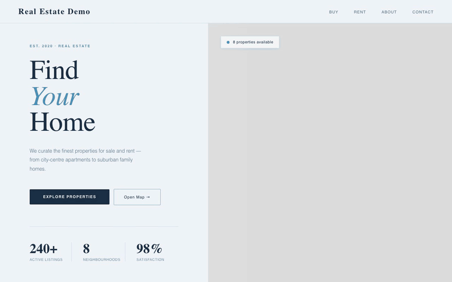
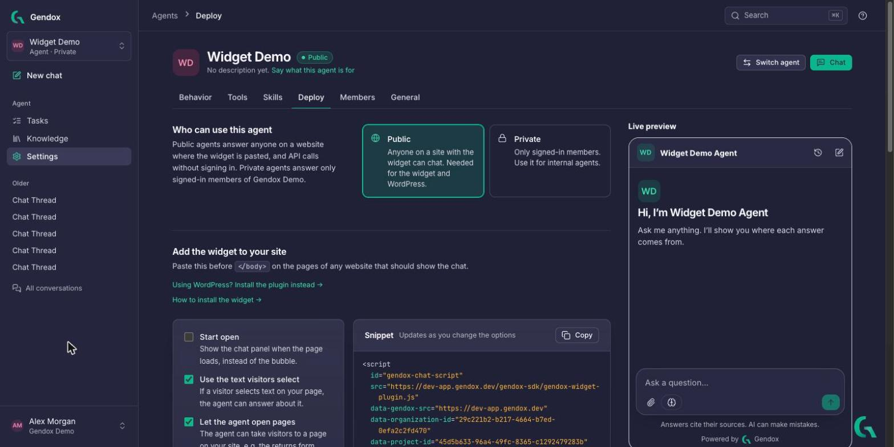

# Installation

:::warning

Features of website widget is in **experimental stage**. Please report any issues you encounter.
Currently, only PUBLIC, existing, manually created projects are supported, with no authentication.
:::

## Introduction
The Gendox chat widget makes a website **agentic**: one `<script>` tag adds an agent that answers from your knowledge base, cites its sources, and can act on the page through [tools](./02-agent-tool-use-and-website-tool-support.md): filter listings, fill forms, open the right page. It works with every model Gendox supports.

In this example a visitor asks a real estate site for rentals in the centre, and the agent sets the site's own filters with the `fill_fields` tool:



## Getting Started
To begin using the Gendox Chat Widget, you must first create an account on the Gendox platform. Follow these steps:
1. **Create a Gendox account** — see [Register and sign in](../01-user-manual/register.md).
2. **Create an agent and give it knowledge** — see [Create your first agent](../01-user-manual/setup-a-project.md) and [Knowledge](../01-user-manual/knowledge.md).
3. **Make the agent Public** _(required for the widget)_: open the agent's **Settings → Deploy** and choose **Public**.
4. **Copy the snippet**: on the same **Deploy** tab, choose the widget options and click **Copy** next to **Snippet**. The snippet already contains your `organizationId` and `projectId`.



The look of the widget (theme, accent and background colours, hello message, suggested questions, disclaimer, branding) is set on the same tab, under **Look and branding**. See [Configure the agent → Deploy](../01-user-manual/configure-the-agent.md#deploy).

## Installation
Paste the snippet before `</body>` on every page that should show the chat (the `<head>` works too). It looks like this:

```html
<script
    id="gendox-chat-script"
    src="https://app.gendox.dev/gendox-sdk/gendox-widget-plugin.js"
    data-gendox-src="https://app.gendox.dev"
    data-organization-id="[organizationId]"
    data-project-id="[projectId]"
    data-gendox-chat-initial-state="closed"
    data-gendox-local-context-selected-text-enabled="true"
    data-gendox-open-web-page-tool-enabled="true"
    data-gendox-local-context-max-responses="1"
    data-gendox-local-context-max-wait-ms="500">
</script>
```


Once this script is included, the Gendox widget will automatically appear in the bottom-right corner of your page.

## Configuration

### 1. Styling
You can easily customize the appearance and position of the Gendox chat widget by overriding its default CSS styles using **CSS specificity**. For example, you can adjust the location of the chat bubble or window using the following CSS:

```css
#gendox-chat-container-id.gendox-chat-container-position {
    position: fixed;
    bottom: 2rem;
    right: 1rem;
    z-index: 1000;
    border-radius: 20px;
}
```


### 2. Parameters
The following parameters can be customized by passing them into the script:

| Data Attribute              | Description                                                                                                                       | Default Value                | Example                                        |
|-----------------------------|-----------------------------------------------------------------------------------------------------------------------------------|------------------------------|------------------------------------------------|
| data-gendox-src             | The base URL for the Gendox chat embed source.                                                                                    | `''` (empty string)          | `data-gendox-src="https://app.gendox.dev"`         |
| data-organization-id        | The unique identifier of your organization within Gendox.                                                                         | `''` (empty string)          | `data-organization-id="org_12345"`              |
| data-project-id             | The unique identifier of the specific project within Gendox.                                                                      | `''` (empty string)          | `data-project-id="proj_abcde"`                  |
| data-gendox-container-id    | The ID assigned to the chat container element. Allows customization of the container element for styling or interaction purposes. | `gendox-chat-container-id`   | `data-gendox-container-id="custom-container-id"`|
| data-gendox-iframe-id       | The ID assigned to the chat iframe element. Allows customization of the iframe element for styling or integration with other components. | `gendox-chat-iframe-id`      | `data-gendox-iframe-id="custom-iframe-id"`      |
| data-gendox-chat-initial-state | Initial chat window state when widget renders. Allowed values: `open`, `closed`.                                              | `closed`                     | `data-gendox-chat-initial-state="open"`         |
| data-gendox-local-context-selected-text-enabled | Enable or disable the SDK's automatically registered selected-text local-context callback. Allowed values: `true`, `false`. | `true` | `data-gendox-local-context-selected-text-enabled="false"` |
| data-gendox-open-web-page-tool-enabled | Enable or disable the SDK's automatically registered `open_web_page` tool handler. Allowed values: `true`, `false`. | `true` | `data-gendox-open-web-page-tool-enabled="false"` |
| data-gendox-session-resume-timeout-ms | How long (ms) a returning visitor continues the same conversation; after that a new one starts. The Deploy tab's **Continue a conversation for** option sets it. Non-negative integer only. | `600000` (10 minutes) | `data-gendox-session-resume-timeout-ms="86400000"` |
| data-gendox-local-context-max-responses | Max number of local context responses to wait for per user message. Positive integer only.                          | `1`                          | `data-gendox-local-context-max-responses="2"`   |
| data-gendox-local-context-max-wait-ms | Max wait time (ms) for local context responses per user message. Non-negative integer only.                            | `200`                        | `data-gendox-local-context-max-wait-ms="1200"`  |


More parameter configurations will be documented in future updates.

### 3. Programmatic Control from Parent App
The widget exposes JS helper methods under `window.gendox.widget` so your app can control chat window state:

```javascript
window.gendox.widget.open()
window.gendox.widget.close()
window.gendox.widget.toggle()
window.gendox.widget.isOpen() // true | false
```

Internally, these methods communicate with the embedded chat via `postMessage`.
They are available after the widget script is initialized.

## Events
The Gendox widget uses the **Post Message API** to exchange messages between the widget and the parent webpage. Developers can set up event listeners to receive notifications from the Gendox chat app and send information back to it.

### Table of Events

| Event Type                                       | Description                                                                                                                                                                          |
|--------------------------------------------------|--------------------------------------------------------------------------------------------------------------------------------------------------------------------------------------|
| gendox.events.initialization.request             | Iframe sends this to the parent SDK on load, requesting initial configuration.                                                                                                       |
| gendox.events.initialization.response            | Parent SDK responds with initial config (`chatInitialState`, `localContextMaxResponses`, `localContextMaxWaitMs`).                                                                    |
| gendox.events.embedded.chat.toggle.request       | Event sent by parent SDK to embedded chat iframe to request state change (`open`, `close`, `toggle`).                                                                              |
| gendox.events.embedded.chat.toggle.action        | Event sent by embedded chat iframe to parent SDK when chat window has opened or closed.                                                                                             |
| gendox.events.listener.removed                   | Event triggered when message listener from parent window has been removed from gendox.                                                                                               |
| gendox.events.chat.message.new.sent              | Event triggered when a message is sent from the user to the gendox chat for completion.                                                                                              |
| gendox.events.chat.message.new.response.received | A completion response has been received.                                                                                                                                             |
| gendox.events.chat.message.context.local.request | Event triggered when gendox requests local context from the parent window. This can be the content of the page that the user is viewing, or the text selected, or whatever you want! |
| gendox.events.chat.message.context.local.response | Gendox is waiting this events from the parent window. Whatever is sent will be included in the local context in the completion message.                                              |
| gendox.events.chat.message.tool_calls.request    | List of Tools that the Agent wants to be executed in the frontend.                                                                                                                   |
| gendox.events.chat.message.tool_calls.response   | Sent by the parent SDK with the results of Sync tools. Each result is given to the agent, which then continues its answer.                                                          |
| gendox.events.chat.message.tool_calls.ack        | Sent by the iframe when the chat has processed a tool result (with an `error` if it was rejected), so the parent SDK stops resending it.                                          |
| gendox.events.chat.message.tool_calls.ready      | Sent by the iframe when it can accept tool results, e.g. after a page reload; the parent SDK then sends any results still pending.                                                |


