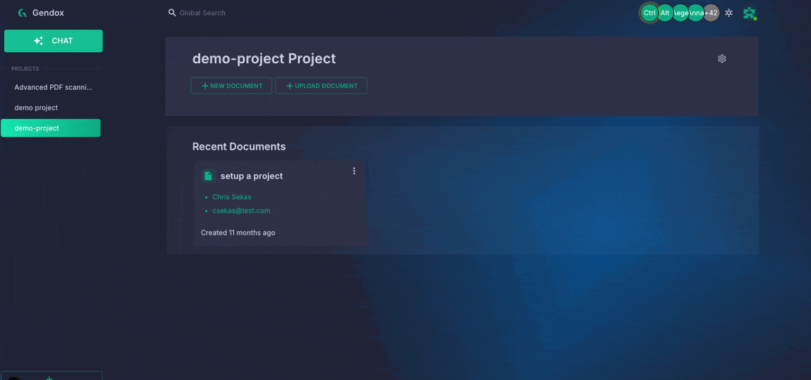

# Tool Use & Front-End Actions

## 1. What is “Tool Use”

Gendox supports a "tool use" mechanism that allows your AI agent to request actions on your website by calling tools that you define.  
Instead of just answering with text, the agent can, for example:

- Open a product page
- Apply or update search/filter options
- Auto-fill a form
- Trigger any custom front-end workflow

When a tool is triggered, the Gendox widget sends a browser `postMessage` event:

```json 
{
   "type": "gendox.events.chat.message.tool_calls.request",
   "payload": [...]
}
``` 
The event payload lists every tool call the agent just made, along with any arguments.

:::note
Chat window initialization and open/close controls are part of the **Widget API** (see Website Widget Installation docs), not the Tool Use API.
:::


**Typical use cases:**

| Tool name        | What you implement in JS      | Example use-case                           |
|------------------|------------------------------|--------------------------------------------|
| `open_web_page`  | `window.location.href = url` | Navigate to a product page (same tab)      |
| `set_filters`    | Update DOM or URL parameters | Filter product listings                    |
| `fill_form`      | Fill input elements          | Speed-fill checkout or inquiry forms       |


## 3. Adding Tools in the Gendox UI

1. **Open your project** → **Settings** → **AI Agent** → **Tools**

2. Click **“Add Tool”**, choose the **Client tool execution** and paste a JSON schema identical to OpenAI’s format.

   | Client tool execution | Behaviour | Use for |
   |---|---|---|
   | **Async — continue without the result** (default) | The agent is told the tool was executed and continues. | Actions: open a page, set filters, fill a form. |
   | **Sync — wait for the host result** | The agent waits until your handler returns, then continues with its result. | Data the agent needs: cart contents, order status, the user's selections. |

Example schema for “open web page”:

```json
{
  "name": "open_web_page",
  "strict": true,
  "description": "Function to open a web page in the browser. Sends an event to the browser to open a new tab with the specified URL.",
  "parameters": {
    "type": "object",
    "required": ["url"],
    "additionalProperties": false,
    "properties": {
      "url": {
        "type": "string",
        "description": "The URL of the web page to open"
      }
    }
  }
}
```

3. **Save**.  
   From now on your agent can decide to call `open_web_page`.

---

## 4. Handling Tool Calls in Your Front End

### 4.1 Add a listener

Gendox SDK is exposed in the browser under window.gendox.tools property. There are 3 important fields related to tool use:
```javascript
window.gendox.tools = {
  allTools: {
     "tool_name": handlerFunction,
     "other_tool_name": anotherHandlerFunction,
  }, // All tools defined in the project
   registerTool, // Function to register a new tool
   removeTool, // Function to remove a tool
};
```

Currently, there is 1 registered default tool: `open_web_page`, which navigates the current tab to the specified URL. To override or add your own tools, use `registerTool(name, handler)`:

```javascript
window.gendox.tools.removeTool('open_web_page'); // Remove existing tool before replacing
window.gendox.tools.registerTool('open_web_page', (args) => {
  // args is the parsed arguments object
   // TODO replace with your implementation here
  console.log("Navigating to:", args.url);
  window.location.href = args.url;
  return { status: "executed" };
});
```

Gendox SDK will automatically call the `handler` function when the agent calls the tool.   
The handler may return a value or a Promise. For a **Sync** tool, that value is sent to the agent as the tool result:

```javascript
window.gendox.tools.registerTool('get_cart', async () => {
  const cart = await fetch('/api/cart').then(r => r.json());
  return { items: cart.items, total: cart.total, currency: cart.currency };
});
```

If the handler throws, the agent receives `{"error":"CLIENT_TOOL_FAILED","message":…}`; if no handler is registered for the name, `{"error":"CLIENT_TOOL_HANDLER_MISSING",…}`.

If you want to handle **Async** tool calls in your own way, you can add a listener to the `message` event in the browser. Sync tools must use `registerTool`, which is how their results are sent back:

```javascript
window.addEventListener('message', (event) => {
  if (event.data.type === 'gendox.events.chat.message.tool_calls.request') {
    const toolCalls = event.data.payload;
    let responses = [];
    toolCalls.forEach((tool) => {
        if (tool.function.name === 'open_web_page') {
            // your implementation here
        } 
        ...
      
    });
  }
});
```


:::warning
**Sync tools wait without a time limit.** While a Sync tool runs, the chat shows *Waiting for your page…* and the user cannot send a message. Add your own timeout to anything that can hang and return an error result when it expires. Don't navigate the page from a Sync tool: its result is lost and the agent receives `CLIENT_TOOL_OUTCOME_UNKNOWN`. Use an Async tool such as `open_web_page` for navigation.
:::

### 4.2  Payload format

The widget sends **an array** (you may receive multiple tool calls at once):

```json
[
  {
    "threadId": "2043baeb-873f-464a-8840-5bf32dd6856a",
    "turnId": "9b1c7e52-3a0f-4d8e-b6a1-2f4c8d9e0a17",
    "messageId": "fe8244bf-ddc7-4ac8-9def-ff9f5163ae2f",
    "execution": "ACTION",
    "function": {
      "name": "open_web_page",
      "arguments": "{\"url\":\"https://example.com\"}"
    },
    "id": "call_abc123",
    "type": "function"
  }
]
```

Field cheat-sheet:

| Field            | Meaning                                     |
|------------------|---------------------------------------------|
| `threadId`       | Chat thread the call belongs to             |
| `turnId`         | The user question the call answers          |
| `messageId`      | Specific message that triggered the call    |
| `execution`      | `ACTION` (Async) or `CLIENT` (Sync: the agent waits for the result) |
| `id`             | Tool call id; a Sync result is matched to the call by it |
| `function.name`  | Tool name you registered in Gendox          |
| `function.arguments` | JSON string with the parameters          |

---

## 5. Step-by-Step Recap

| Step | What you do                                                                                               |
|------|-----------------------------------------------------------------------------------------------------------|
| 1.   | Define tools in **Project → Settings → AI Agent → Tools** (OpenAI-style JSON schema).                     |
| 2.   | Deploy the usual Gendox widget `<script …>` tag on your site.                                             |
| 3.   | Add a `window.addEventListener('message', handler)` in your front-end.                                    |
| 4.   | In the handler, look for `type === 'gendox.events.chat.message.tool_calls.request'`.                      |
| 5.   | Parse `event.data.payload`, match each `function.name`, run your own JS (open tab, modify DOM, etc.).     |
| 6.   | For Sync tools, register a handler with `window.gendox.tools.registerTool` instead; its return value is sent to the agent. |

---

### 6. Gotchas & Best Practices

* **Results:** only Sync tools send a result to the agent; return just the data it needs, as the result is saved in the chat thread.
* **Security:** validate the arguments (`new URL(url)`, whitelists, etc.) before executing.
* **Multiple calls:** the array may contain more than one tool invocation—loop through it.
* **Versioning:** schema changes won’t break old widgets, but keep your handler switch-case up-to-date.

---

Happy building!  
With Gendox Tool Use you can turn any website from a static page into an interactive AI Agent that **navigates**, **filters**, and **controls** your site.
