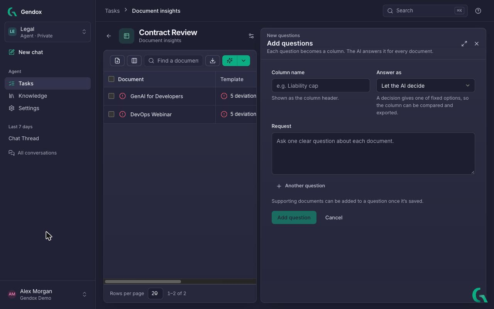
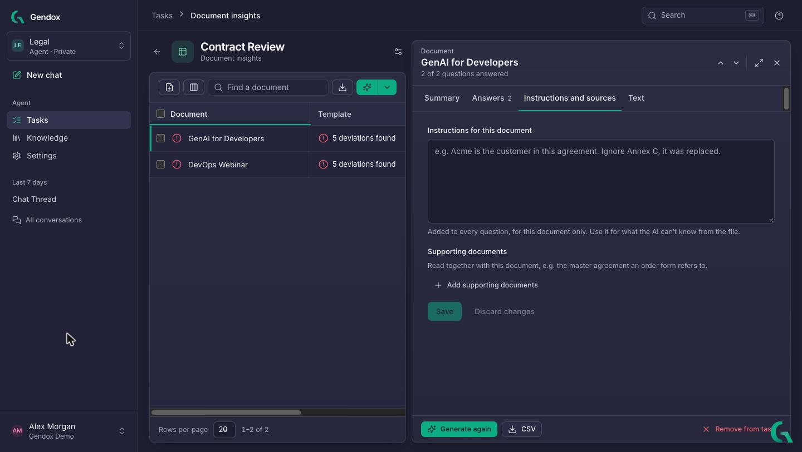
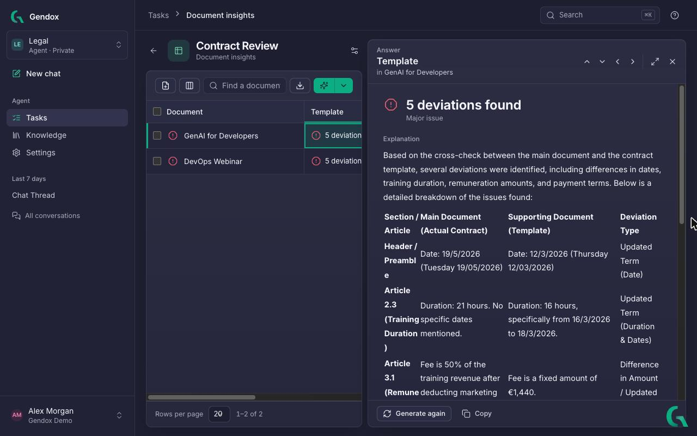
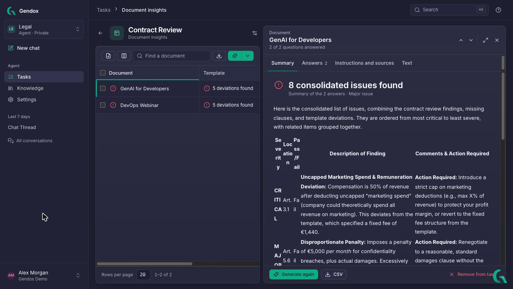
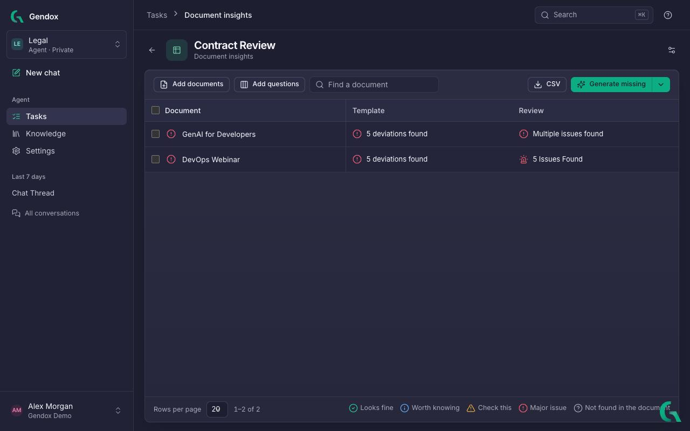
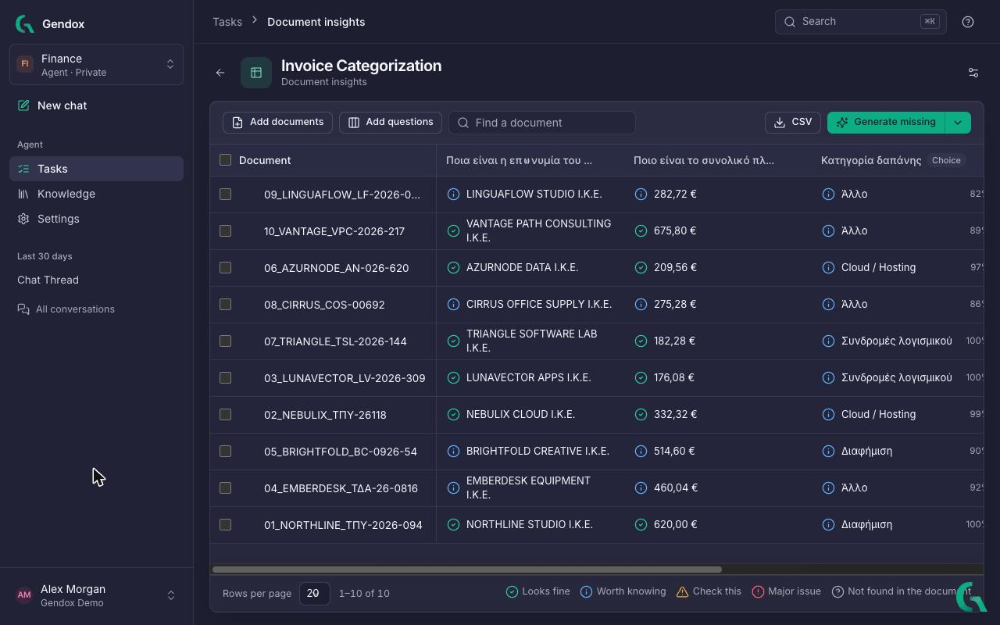

# Document Insights

import insightsDemo from './img/v2/insights-browse-answers.gif';

**Document Insights** asks the same questions of many documents at once. The results form a **table**: one row per document, one column per question. Every answer has a short value, a detailed explanation and a colour-coded **status flag**, and each document can get a summary of its answers. Export everything to CSV.

Typical uses: reviewing contracts against a template, categorizing invoices, checking reports for required clauses, extracting the same fields from many files.

## Quick demo

Browsing the results of an invoice categorization task: open an answer, move to the next document with the arrow keys, open a document's answers and the text Gendox read from it.

---

## Create the task

1. Open **Tasks** in the sidebar and click **Document insights** (or **New task** → **Document insights**).
2. Give it a **Name**, for example *Contract Review*.
3. Tick **Write a summary of each document** if you want one summary per row.
4. Optionally, under **Instructions and model**, add **Extra instructions** for every document (e.g. *Quote the clause your answer comes from.*) or pick another model.
5. Click **Create task**.

See [Tasks](../01-user-manual/tasks.md#create-a-task) for every option.

---

## Add questions

Click **Add questions**. Each question becomes a **column**.

| Field | What to enter |
|---|---|
| **Column name** | Short header, e.g. *Liability cap*. |
| **Answer as** | **Let the AI decide**, **Written answer**, or **A decision**. |
| **Request** / **Question** | One clear question about each document. |

**A decision** gives one of fixed options, so the column can be compared, filtered and exported cleanly:

| Decision kind | Example |
|---|---|
| **Yes / No** | *Does the contract have a termination clause?* You describe what Yes and No mean. |
| **Choice** | *Expense category*: Cloud / Hosting, Software subscriptions, Advertising, Other. |
| **Rating** | *Risk level*: Low, Medium, High (levels, lowest first). |

Click **Another question** to add several at once, then **Add question**.

Once a question is saved you can attach **supporting documents** to it: reference material the AI reads together with each document, such as a contract template to compare against.

---

## Add documents

Click **Add documents**. Upload files, or pick documents already in the agent's knowledge. Each document becomes a **row**. PDF, Word, Excel, PowerPoint, text and more are supported.

### Instructions for one document

Click a document's name, then **Instructions and sources**:

- **Instructions for this document** are added to every question, for this document only. Use them for what the AI can't know from the file, e.g. *Acme is the customer in this agreement. Ignore Annex C, it was replaced.*
- **Supporting documents** are read together with this document, e.g. the master agreement an order form refers to.

Saving these changes clears the existing answers of that document, so they can be generated again.

---

## Generate the answers

Click **Generate missing** and confirm. Every empty cell is filled; existing answers are kept.

| Option | Behaviour |
|---|---|
| **Generate missing** | Fills only empty cells. |
| **Generate selected (N)** | Tick documents first: fills the empty cells of those rows. |
| **Regenerate everything** (arrow menu) | Replaces every answer, also ones you checked. Can't be undone. |
| **Generate again** (in an answer or document panel) | Regenerates that one answer or document. |

Generation runs in the background. A progress bar shows **Generating answers**; **Stop** ends it early.

---

## Read the results

### Status flags

The legend at the bottom of the table explains the flags:

| Flag | Meaning |
|---|---|
| **Looks fine** | Compliant or positive result. |
| **Worth knowing** | Informational, no action needed. |
| **Check this** | A possible issue worth reviewing. |
| **Minor issue** | A small problem. |
| **Major issue** | A significant problem. |
| **Critical issue** | A serious risk or non-compliance. |
| **Not found in the document** | The question doesn't apply, or the document doesn't say. |

### An answer

Click a cell to open the answer beside the table: its value, its flag and the full **Explanation**. Use **↑ ↓ ← →** to move to other cells, **Copy** to copy it, **Generate again** to regenerate it.

For a **decision** column, the panel also shows how confident the AI was in each option.

### A document

Click a document's name to open its panel:

| Tab | Shows |
|---|---|
| **Summary** | The summary of all its answers (if the task writes summaries). |
| **Answers** | Every answer for this document, one under the other. |
| **Instructions and sources** | See above. |
| **Text** | The text Gendox read from the file, which every answer is based on. |

---

## Example: contract review

A *Legal* agent cross-checks signed contracts against a **template contract** and reviews each one:

| Column | Question |
|---|---|
| **Template** | Cross-check the contract against the template and report deviations: amounts, removed terms, new terms, updated terms. *(The template is attached as a supporting document.)* |
| **Review** | Review the contract for unfavourable terms, missing clauses and items to update. |

Each contract gets *5 deviations found* in the Template column and its issues in the Review column, flagged **Major issue**. The document summary lists the consolidated findings by severity, with the action required for each.

## Example: invoice categorization

A *Finance* agent reads ten supplier invoices and fills a column for the supplier, the total with VAT, and a **Choice** column for the expense category.

You can then ask the [Gendox assistant](../01-user-manual/workspace-tour.md#gendox-assistant) about the results, e.g. *Which invoices are Cloud / Hosting?*

---

## Export

- **CSV** in the toolbar exports the whole table.
- **CSV** in a document's panel exports that document only.

---

## Tips

- Start with two or three documents: select them, **Generate selected**, check the answers, then generate the rest.
- Prefer **A decision** when you will filter or count the results; prefer **Written answer** when you need the reasoning.
- Put shared context in the task's **Extra instructions**, and document-specific context in that document's **Instructions**.
- Attach reference material (templates, policies) as **supporting documents** to the question that needs it.
