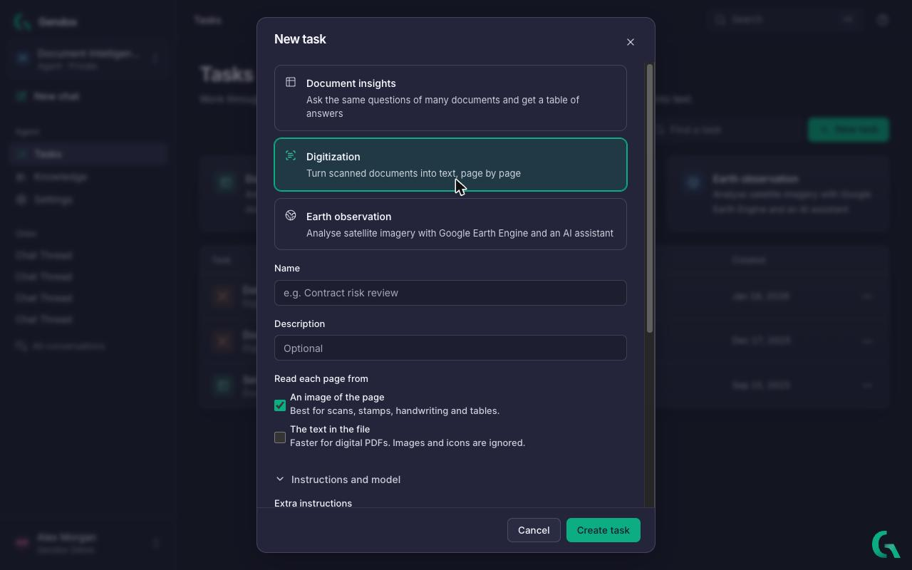
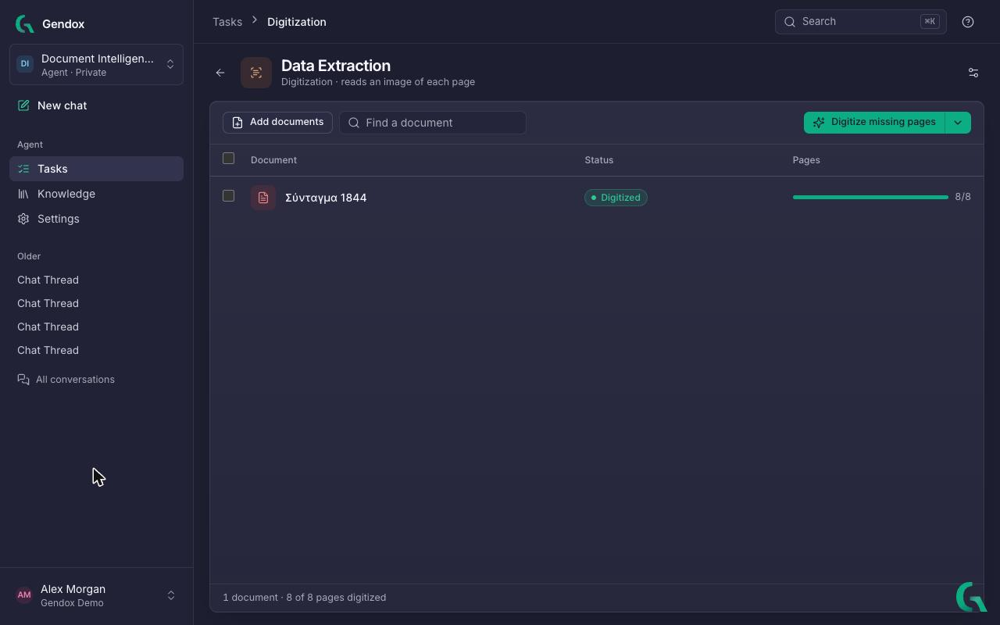
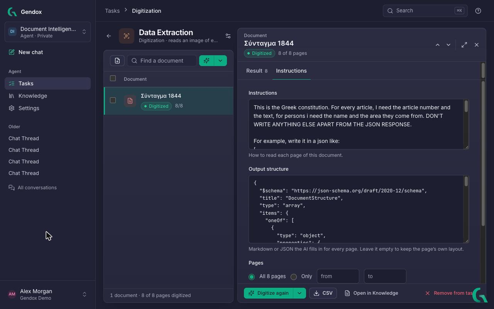
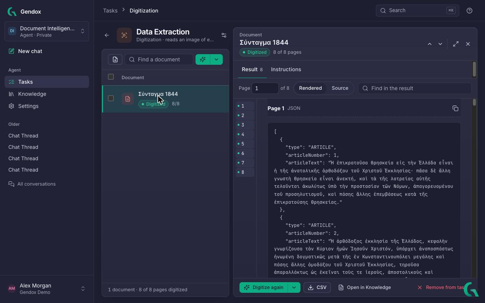

# Document Digitization

import digitizationDemo from './img/v2/digitization-read-results.gif';

**Document Digitization** turns scanned PDFs and office files into clean, machine-readable text **page by page**. Each page is read by a vision-capable AI model instead of traditional OCR, so it copes with stamps, handwriting, tables and old print. Add an **output structure** (a JSON schema) to extract the same fields from every page, then export everything to CSV.

Supported input: PDF, Word, Excel, PowerPoint, plain text, Markdown, CSV and more.

## Quick demo

Reading the results of a digitized document: every page turned into structured JSON, in the rendered view and as source.


---

## Create the task

1. Open **Tasks** in the sidebar and click **Digitization** (or **New task** → **Digitization**).
2. Give it a **Name**.
3. Choose **Read each page from**:

| Option | Best for |
|---|---|
| **An image of the page** | Scans, stamps, handwriting and tables. Each page is rendered as an image for a vision model. |
| **The text in the file** | Digital PDFs and office files. Faster and cheaper; images and icons are ignored. |

4. Optionally add **Extra instructions** and choose a **Model** under **Instructions and model**.
5. Click **Create task**.



---

## Add documents

Click **Add documents** and upload files, or pick documents already in the agent's knowledge. Each document shows a status:

| Status | Meaning |
|---|---|
| **Not digitized** | No pages done yet. |
| **Digitizing** | The task is reading its pages now. |
| **N pages missing** | Some pages are done, others are not. |
| **Digitized** | Every page is done. |
| **Can't be digitized** | The file format isn't supported. |



---

## Tell it what to extract

Click a document, then **Instructions**:

- **Instructions**: how to read each page of this document, in plain language. For example: *This is the Greek constitution. For every article, give the article number and its text. For persons, give the name and the area they come from.* Leave it empty to get the page as clean Markdown.
- **Output structure**: Markdown or a **JSON schema** the AI fills in for every page. Leave it empty to keep the page's own layout.
- **Pages**: **All pages**, or **Only** a range *from*–*to*.



Example schema for invoices:

```json
{
  "type": "object",
  "properties": {
    "invoice_number": { "type": "string" },
    "date": { "type": "string" },
    "total_amount": { "type": "number" },
    "line_items": {
      "type": "array",
      "items": {
        "type": "object",
        "properties": {
          "description": { "type": "string" },
          "quantity": { "type": "number" },
          "unit_price": { "type": "number" }
        }
      }
    }
  }
}
```

---

## Digitize

Click **Digitize missing pages** and confirm. Pages already done are kept.

| Option | Behaviour |
|---|---|
| **Digitize missing pages** | Reads every page that isn't done yet. |
| **Digitize selected (N)** | Tick documents first: reads their missing pages. |
| **Digitize everything again** (arrow menu) | Reads every page again and replaces its text. Can't be undone. |
| **Digitize again** (in a document's panel) | Reads that document again. |

The task runs in the background, one AI call per page, in parallel. A progress bar shows **Digitizing**; **Stop** ends it early.

---

## Read the results

Click a document to open it beside the list, on the **Result** tab:

- Jump to a **Page**, or click a page number on the left.
- **Rendered** shows formatted Markdown or JSON; **Source** shows the raw output.
- **Find in the result** searches the text of every page.
- The copy button copies a page's result.
- **Use the whole width** (expand icon) gives the reader the full screen.



**Open in Knowledge** opens the original document in the agent's knowledge.

---

## Export

**CSV** in a document's panel exports its pages: one row per page, with the page number and its output.

---

## Tips

- Try **Digitize selected** on one or two documents to check your instructions and schema before running a large batch.
- For pages with nothing useful, say what to return in the instructions, e.g. *If the page has no article, return an empty array.*
- Use **The text in the file** for born-digital PDFs: it is faster and cheaper.
- To make digitized text answerable in chat, you can also turn on **Read scanned pages with AI** for the agent's knowledge ([Configure the agent → General](../01-user-manual/configure-the-agent.md#general)).
