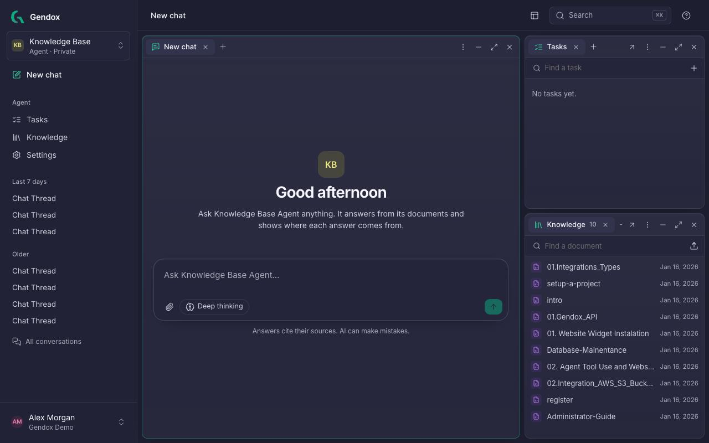

# Gendox: the Document Intelligence Harness

**Gendox turns your documents into knowledge bases, AI agents and structured data, and puts those agents to work on any website.**

Give an agent your files, websites or WordPress content and tell it how to behave. Gendox reads and sections the documents, searches them and cites every answer. Use the agent in the app, on your website, where it can also act on the page (an *agentic website*), or from your own software. Run the same questions over hundreds of documents with tasks.



## What you can do

| You want to… | Use | Start here |
|---|---|---|
| Ask questions and get answers with sources | **Chat** with an agent | [Chat with an agent](./01-user-manual/chat.md) |
| Give an agent knowledge | **Knowledge**: upload files, write documents, read websites, connect WordPress | [Knowledge](./01-user-manual/knowledge.md) |
| Shape how it answers, give it tools and skills | Agent **Settings** | [Configure the agent](./01-user-manual/configure-the-agent.md) |
| Ask the same questions of many documents | **Document insights** tasks | [Document Insights](./07-document-insights/01-document-insights.md) |
| Turn scans into text or structured data | **Digitization** tasks | [Document Digitization](./08-document-digitization/01-document-digitization.md) |
| Analyse satellite imagery | **Earth observation** tasks | [Earth Observation](./06-earth-observation/02-user-guide.md) |
| Make your website agentic: an agent that answers and acts on the page | The chat **widget** with tools, or the **WordPress** plugin | [Website Widget](./03-website-widget/01-website-widget-installation.md) |
| Call the agent from your app | The **API** with an API key | [Gendox API](./02-api/01-gendox-api.md) |
| Work as a team | **Organizations**, **members** and **roles** | [Invite people](./01-user-manual/invite-user.md) |

## Key ideas

- **Organization**: your team's workspace. Members, agents, API keys and billing belong to it. You can belong to several.
- **Agent**: an AI assistant with its own knowledge, instructions, model, tools and skills. (In the API and in older pages, an agent and its knowledge are called a **project**.)
- **Knowledge**: the documents an agent searches. Gendox splits each document into **sections** and cites the sections it used.
- **Task**: AI work over many documents at once, with results in a table you can review and export.
- **Public or private**: a public agent answers anyone on a website with its widget; a private agent answers only signed-in members.

## Get started in five minutes

1. [Register and sign in](./01-user-manual/register.md).
2. [Create your first agent](./01-user-manual/setup-a-project.md) and give it a document.
3. [Ask it a question](./01-user-manual/chat.md).
4. [Find your way around the app](./01-user-manual/workspace-tour.md).

## Running Gendox yourself

Gendox is open source. To run it on your own servers or develop it, see the [repository](https://github.com/ctrl-space-labs/gendox-core) and the [Maintenance](./05-maintenance/administrator-guide.md) section, including [local test environments](./05-maintenance/ephemeral-environments.md) and the [end-to-end tests](./05-maintenance/e2e-tests.md).

## For AI agents reading these docs

Each page starts with a one-line `description` and is organized as steps and tables, using the exact names of buttons and fields in the app (in **bold**). Navigation is written as *Place → Button*, for example **Settings → Deploy**. An index of every page is at <a href="/llms.txt" target="_self">/llms.txt</a>.

---

## For AI Coding Assistants

If you are an AI coding agent (Cursor, Claude Code, OpenAI Codex, etc.) helping a developer integrate Gendox into their project, use the ready-made Agent Skills in this repository.

### Where skills live

Skills are served as static files at <a href="/skills/" target="_self">/skills/</a>. Open that URL for the catalog, or copy a skill folder into your project's skill directory:

| Agent | Skill directory |
|-------|----------------|
| Cursor / OpenAI Codex | `.agents/skills/<skill-name>/` |
| Claude Code | `.claude/skills/<skill-name>/` |

For example, for Claude Code (use `.agents/skills` for Cursor or Codex):

```bash
d=.claude/skills/gendox-widget-integration
mkdir -p $d/references
curl -fsSL https://docs.gendox.dev/skills/gendox-widget-integration/SKILL.md -o $d/SKILL.md
curl -fsSL https://docs.gendox.dev/skills/gendox-widget-integration/references/tools-and-local-context.md -o $d/references/tools-and-local-context.md
```

For WordPress, also install `gendox-wordpress-integration` (one `SKILL.md`) next to it.

### Available skills

| Skill | What it covers |
|-------|---------------|
| <a href="/skills/gendox-widget-integration/SKILL.md" target="_self">gendox-widget-integration</a> | Embed the Gendox chat widget, wire up local page context, and register browser-side agent tools. See the [Website Widget docs](./03-website-widget/01-website-widget-installation.md) for the descriptive human guides. |
| <a href="/skills/gendox-wordpress-integration/SKILL.md" target="_self">gendox-wordpress-integration</a> | Set up the Gendox WP AI Agent plugin, and register agent tools/local context on WordPress specifically. See the [WordPress Plugin docs](./03-website-widget/04-wordpress-plugin.md) for the descriptive human guide. |

### How to invoke a skill

After copying the folder, invoke it from the agent chat:

```
/gendox-widget-integration
```

Or describe your task and the agent will load the skill automatically based on its description.

---

Happy innovating with Gendox!


